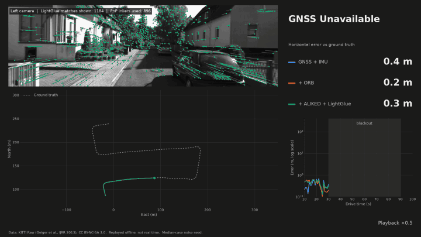
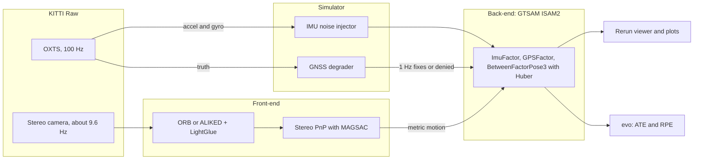
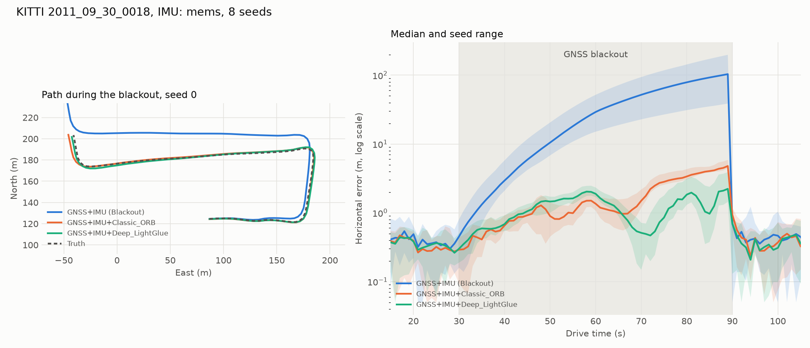

## gnss-denied-navigation-test for automobile
An testbed for GNSS-denied navigation. Pre-trained perception extracts motion
from a stereo camera, and a GTSAM factor graph fuses it with an IMU and whatever GNSS is left.

No hardware is needed. The sensors come from the public [KITTI Raw](https://www.cvlibs.net/datasets/kitti/raw_data.php)
dataset, and GNSS failures are injected by a simulator.



The full 68 s video is at [`assets/demo.mp4`](assets/demo.mp4).

## Architecture



## Quickstart

Tested on macOS with Apple Silicon and Python 3.11, using [uv](https://docs.astral.sh/uv/). Linux
and Colab have not been tested yet.

```bash
uv sync --python 3.11 --extra all
uv run --extra all pytest
```

Fetch the data. This reads only what is needed from the 28 GB archives, about 1.5 GB in total:

```bash
uv run --extra all python data/download_sample.py
```

Check the merged sensor streams, then run the classic front-end and fuse it:

```bash
uv run --extra all python scripts/inspect_streams.py
uv run --extra all python scripts/run_visual_odometry.py --backend orb
uv run --extra all python scripts/run_pipeline.py --imu-profile mems --vo orb
uv run --extra all rerun assets/blackout_mems_orb.rrd
```

Run the learned front-end (downloads about 50 MB of weights, and took 19 minutes on an Apple M5),
then the full benchmark:

```bash
uv run --extra all python scripts/run_visual_odometry.py --backend aliked
uv run --extra all python scripts/evaluate_metrics.py
```

Render the demo video and the README loop from those results. The script picks the median-case
seed itself:

```bash
uv run --extra all python scripts/render_demo.py --gif assets/demo.gif
```

Scenarios, including the blackout window and the failure modes, are set in
[`configs/default_sim.yaml`](configs/default_sim.yaml).

## Results

KITTI `2011_09_30_drive_0018`, with a 60 s blackout from 30 s to 90 s over about 410 m. Each cell
is the median [min, max] over 8 seeds. Errors are from the online estimate, with no trajectory
alignment. Two IMU profiles are compared: `raw` is the OXTS as recorded, and `mems` adds noise
roughly matching an industrial MEMS unit.

| IMU | Mode | ATE full drive (m) | ATE blackout (m) | End of blackout (m) | RPE 10 s, translation (m) | RPE 10 s, rotation (deg) |
|---|---|---|---|---|---|---|
| `raw` | GNSS+IMU (Blackout) | 12.87 [8.88, 16.60] | 28.17 [19.42, 36.35] | 60.40 [45.17, 79.68] | 10.20 [7.61, 13.12] | 0.18 [0.17, 0.18] |
| `raw` | GNSS+IMU+Classic_ORB | 1.29 [1.12, 1.41] | 2.60 [2.22, 2.87] | 4.74 [4.40, 5.26] | 1.42 [1.41, 1.43] | 0.18 [0.18, 0.19] |
| `raw` | GNSS+IMU+Deep_LightGlue | 0.94 [0.77, 1.08] | 1.71 [1.30, 2.10] | 1.01 [0.68, 1.51] | 0.86 [0.86, 0.86] | 0.17 [0.17, 0.18] |
| `mems` | GNSS+IMU (Blackout) | 23.40 [9.17, 41.22] | 51.24 [20.04, 90.29] | 103.55 [38.71, 197.84] | 18.79 [7.74, 35.57] | 0.28 [0.23, 0.52] |
| `mems` | GNSS+IMU+Classic_ORB | 1.29 [1.09, 1.41] | 2.61 [2.13, 2.89] | 4.79 [4.44, 5.88] | 1.51 [1.50, 1.55] | 0.31 [0.27, 0.34] |
| `mems` | GNSS+IMU+Deep_LightGlue | 1.02 [0.78, 1.11] | 1.96 [1.31, 2.17] | 2.23 [1.44, 3.89] | 1.06 [1.01, 1.12] | 0.38 [0.33, 0.42] |

Deep_LightGlue here means ALIKED keypoints matched by LightGlue. Front-end speed on an Apple M5,
measured once: ORB 18 frames/s, ALIKED + LightGlue 2.4 frames/s, against a camera at about 9.6
frames/s.



### How to read these numbers

- **Vision removes most of the drift.** End-of-blackout error falls by about 92 to 98%.
- **The learned front-end is better overall, not at every moment.** ORB is ahead for part of the
  blackout, between about 45 s and 65 s in the plot above.
- **Better frame-to-frame matching did not mean less standalone drift.** Per frame, ALIKED is far
  less noisy than ORB, yet chaining VO alone over the blackout drifted 12.1 m against ORB's 8.3 m.
  Its forward motion shows a small constant error, about 1% per frame. The cause has not been
  investigated.
- **Vision does not help attitude on this drive.** Rotation RPE stays flat with `raw` and gets
  slightly worse with `mems`, most likely because the noise assumed for VO rotation is not tuned to
  each front-end.

### Limitations

- **One drive.** All numbers come from a single daylight urban sequence, which is easy for vision.
  Noise settings were chosen on this same drive, with no held-out test sequence.
- **Replay, not real time.** ALIKED + LightGlue is about 4 times too slow for the camera on this
  machine. Results come from cached odometry, and latency is not modelled.
- **GNSS attacks are simulated but not defended against.** `URBAN_CANYON` and `SPOOFING` can be
  generated, but `GPSFactor` has no robust noise model and these modes have not been benchmarked.
- **Initial state comes from ground truth.** Attitude and velocity at the start are taken from the
  dataset, standing in for an alignment step.
- **No loop closure or map matching.** Frames are only matched to their predecessor, so error still
  grows over a long enough blackout.

## Repository layout

```text
configs/default_sim.yaml        Blackout windows, IMU profiles and VO noise
data/download_sample.py         Selective KITTI downloader
src/gnss_denied/core/           Types, geodesy and stream merging
src/gnss_denied/datasets/       KITTI Raw loader and calibration
src/gnss_denied/simulator/      GNSS degrader and IMU noise injector
src/gnss_denied/frontend/       Stereo VO, ORB and ALIKED + LightGlue backends
src/gnss_denied/backend/        GTSAM factor graph and dead reckoning
src/gnss_denied/viz/            Rerun logger and plots
src/gnss_denied/pipeline.py     Runs the fusion over recorded streams
src/gnss_denied/evaluation.py   ATE and RPE through evo
scripts/                        Command-line entry points
tests/                          Unit tests, which need no dataset
```

## Good first issues

1. **Add a satellite ortho-photo cross-view matcher.** Implement `frontend/map_matcher.py`: match
   camera frames against georeferenced tiles and add the result as an absolute position factor.
   VO alone cannot remove accumulated drift, and this can. Done when end-of-blackout error drops
   on the benchmark.
2. **Add a neural IMU denoiser.** Train or adopt a small network that corrects raw IMU samples
   before pre-integration, and add it as a mode in `scripts/evaluate_metrics.py`. Done when it
   improves on the `GNSS+IMU (Blackout)` row on a drive that was not used for training.
3. **Add a ROS 2 bag playback node.** Feed `ImuMeasurement`, `GnssMeasurement` and stereo frames
   from a bag into the existing pipeline. Done when a recorded bag gives the same results as the
   equivalent KITTI run.

## Credits and licences

- [KITTI](https://www.cvlibs.net/datasets/kitti/) data is CC BY-NC-SA 3.0, for non-commercial use.
  Please cite Geiger et al., "Vision meets Robotics: The KITTI Dataset", IJRR 2013.
- [GTSAM](https://gtsam.org/), [kornia](https://kornia.org/),
  [Rerun](https://rerun.io/) and [evo](https://github.com/MichaelGrupp/evo) do the heavy lifting.
  Check the licences of the pre-trained weights before any commercial use.

The code is licensed under the [GNU General Public License v3.0 or later](LICENSE). This covers the
code only. The KITTI frames in `assets/` (the demo video, GIF and plots) are derived from KITTI and
stay under CC BY-NC-SA 3.0, and the dataset itself is not included.
