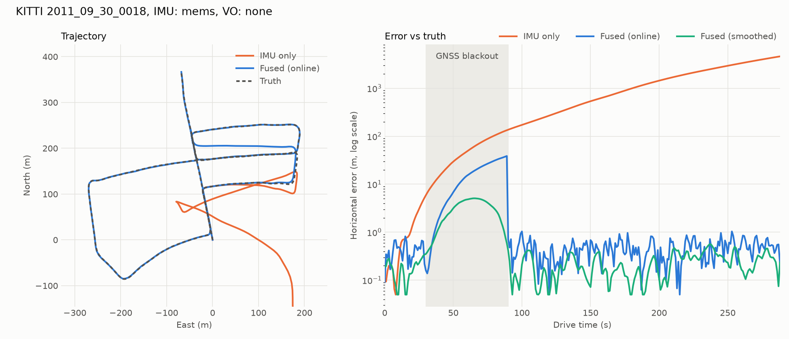
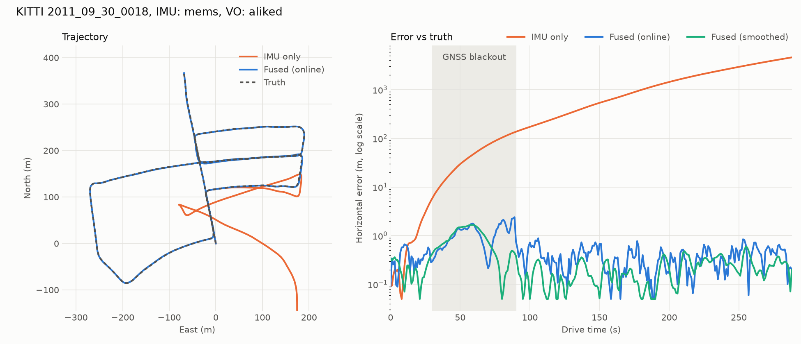
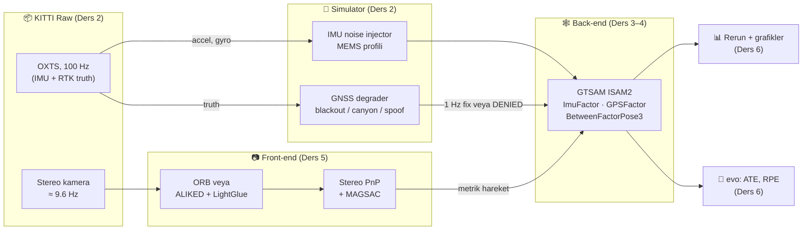

<div align="center">

# 🧭 Ders 0 · Büyük Resim

**Faz: hazırlık** · ⏱️ ~1 saat · 📐 Matematik: ★☆☆☆

[İçindekiler](README.md) · [Ders 1 →](01_geodesy_and_frames.md)

</div>

---

## 🎯 Öğrenme hedefleri

Bu dersin sonunda şunları yapabileceksin:

- [ ] GNSS'in konumu nasıl hesapladığını ve neden bu kadar kolay bozulduğunu açıklamak
- [ ] **Relative** ve **absolute** sensör farkını ve bunun "drift" ile ilişkisini anlatmak
- [ ] Projenin uçtan uca veri akışını bir diyagram üzerinde göstermek
- [ ] Kurs boyunca kullanılacak notasyonu (`T_a_b`, ENU, body frame) okumak

---

## 💡 1. Problem: GNSS gidince ne olur?

**GNSS** (Global Navigation Satellite System), GPS, Galileo, GLONASS ve BeiDou'nun ortak adıdır.
Telefonundaki mavi nokta, otonom araçların ve drone'ların konum bilgisi çoğunlukla buradan gelir.

GNSS'in kalbinde basit bir fikir var: uydudan çıkan sinyalin sana ne kadar sürede ulaştığını
ölçersen, uyduya olan **mesafeni** bilirsin. Birkaç uyduya olan mesafeni bilirsen, konumun bu
kürelerin kesişimidir.

### 📐 Pseudorange denklemi

Her uydu $s$ için ölçülen "sözde mesafe" (**pseudorange**):

$$
\rho_s = \lVert \mathbf{p}_s - \mathbf{p} \rVert + c\,\delta t + \varepsilon_s
$$

| Sembol | Anlamı |
|---|---|
| $\mathbf{p}_s$ | Uydunun konumu (biliniyor, sinyalin içinde geliyor) |
| $\mathbf{p}$ | Senin konumun (bilinmiyor, 3 sayı) |
| $c\,\delta t$ | Alıcı saatinin hatası × ışık hızı (bilinmiyor, 1 sayı) |
| $\varepsilon_s$ | Atmosfer, **multipath** (yansıma), gürültü |

Toplam **4 bilinmeyen** var, bu yüzden en az **4 uydu** görmen gerekir. Alıcının ucuz saati
1 µs bile şaşsa, bu $c \cdot 10^{-6} \approx 300$ m hata demek. Saat hatasını da bilinmeyen olarak
çözmenin sebebi bu.

### ⚠️ Neden bu kadar kırılgan?

Uydu sinyali yeryüzüne ulaştığında gücü yaklaşık **−130 dBm** olur, yani termal gürültünün
altındadır. Sonuç olarak:

| Senaryo | Ne oluyor? | Projede adı |
|---|---|---|
| 🚇 Tünel, kapalı otopark | Sinyal hiç yok | `BLACKOUT` |
| 🏙️ Yüksek binalar | Sinyal binalardan yansıyor, büyük sıçramalar | `URBAN_CANYON` |
| 📡 **Jamming** | Biri aynı frekansta gürültü basıyor, sinyal kayboluyor | `BLACKOUT` gibi davranır |
| 🎭 **Spoofing** | Biri sahte uydu sinyali üretiyor, alıcı yanlış konumu "geçerli" sanıyor | `SPOOFING` |

**GNSS-denied navigation**, bu durumlarda da konumu kabul edilebilir bir hatayla bilmeye
çalışan alandır.

---

## 💡 2. Ana fikir: relative ve absolute sensörler

Bütün kurs tek bir fikrin üzerine kurulu. Bunu iyice sindir:

> [!IMPORTANT]
> **Relative** (göreli) sensörler sadece *ne kadar hareket ettiğini* söyler, hataları birikir
> (**drift**). **Absolute** (mutlak) sensörler *nerede olduğunu* söyler, hatası birikmez ama her
> zaman erişilebilir değildir. İyi bir navigasyon sistemi ikisini birleştirir.

| Sensör | Tip | Ne ölçer? | Hata davranışı |
|---|---|---|---|
| **IMU** (accelerometer + gyroscope) | Relative, **proprioceptive** | İvme ve açısal hız | Zamanla $t^2$, hatta $t^3$ ile büyür |
| **Kamera** (visual odometry) | Relative, **exteroceptive** | Kareler arası hareket | Mesafeyle yaklaşık doğrusal büyür |
| **GNSS** | Absolute | Konum | Sınırlı (≈ 0.5–5 m), ama kesilebilir |
| Uydu haritası eşleştirme | Absolute | Konum | Sınırlı, haritaya bağlı (bu projede yok) |

*Proprioceptive* = aracın kendi içini ölçen sensör (IMU). *Exteroceptive* = dış dünyaya bakan
sensör (kamera, lidar).

### Drift'i sezgisel olarak hissetmek

Gözün kapalı yürüdüğünü düşün. Adım sayarak nerede olduğunu tahmin ediyorsun. Her adımda 1 cm
yanılsan, 1000 adım sonra metrelerce hata yaparsın. Bu **dead reckoning**'dir (eski denizcilikten
gelen bir terim: hız, yön ve süreyle konumu ileri taşımak).

Arada bir gözünü açıp bir binaya bakarsan (absolute bilgi), hatan sıfırlanır. GNSS blackout'u,
"gözünü uzun süre açamadığın" durumdur. Bu projenin sorusu şu:

> *Gözün kapalıyken, adım saymaktan daha iyi ne yapabiliriz?*

Cevap: **kamerayla etrafına bakmak**. Kamera da relative bir sensör ama IMU'dan çok daha yavaş
drift eder. Sonuçlar bunu gösteriyor:



*Yukarıda: sadece IMU + GNSS. Blackout başlayınca (gri bölge) hata hızla büyüyor.*



*Yukarıda: aynı senaryo, kamera eklenmiş. Hata metre seviyesinde kalıyor.*

---

## 💡 3. Füzyon neden "olasılık" problemi?

Her sensör hatalı. Bu yüzden bir konumu "bilmek" yerine, konum hakkında bir **inanç**
(**belief**) tutarız: en olası değer ve ne kadar emin olduğumuz.

En çok kullanılan inanç modeli **Gaussian** (normal) dağılımdır:

$$
\mathbf{x} \sim \mathcal{N}(\boldsymbol{\mu}, \boldsymbol{\Sigma})
$$

- $\boldsymbol{\mu}$ (**mean**): en iyi tahmin
- $\boldsymbol{\Sigma}$ (**covariance**): belirsizliğin büyüklüğü ve şekli

İki bağımsız ölçümü birleştirmenin en basit örneği, sezgiyi tek satırda verir. Aynı büyüklüğü
$z_1$ (varyansı $\sigma_1^2$) ve $z_2$ (varyansı $\sigma_2^2$) olarak ölçtüysen, en iyi tahmin
**ağırlıklı ortalamadır**:

$$
\hat{x} = \frac{\sigma_2^2\, z_1 + \sigma_1^2\, z_2}{\sigma_1^2 + \sigma_2^2},
\qquad
\frac{1}{\hat{\sigma}^2} = \frac{1}{\sigma_1^2} + \frac{1}{\sigma_2^2}
$$

Bu iki formülün söylediği şey:

1. **Daha güvenilir ölçüm daha çok söz hakkı alır.** Varyansı küçük olanın ağırlığı büyüktür.
2. **Bilgi toplanır.** $1/\sigma^2$'ye **information** denir; ölçüm ekledikçe information artar,
   belirsizlik hiçbir zaman büyümez.

Ders 4'te göreceğin **factor graph**, bu fikrin binlerce değişkene ve doğrusal olmayan
ölçümlere genellenmiş halidir.

---

## 🏗️ 4. Projenin mimarisi



Bu diyagramı aklında tut. Her ders bu kutulardan birini açıp içini anlatıyor:

| Kutu | Tek cümlelik görevi | Ders |
|---|---|---|
| **Geodesy** | Enlem/boylamı metre cinsinden düz bir koordinata çevirir | 1 |
| **KITTI loader** | Ham dosyaları zaman damgalı ölçüm akışına çevirir | 2 |
| **Degraders** | Kusursuz veriyi gerçekçi, bozuk sensör verisine çevirir | 2 |
| **IMU integration** | İvme ve açısal hızdan konum ve yönelim üretir | 3 |
| **Factor graph** | Bütün ölçümleri tek bir optimizasyon probleminde birleştirir | 4 |
| **Visual odometry** | İki kamera karesinden metrik hareket çıkarır | 5 |
| **Evaluation** | Tahmini gerçekle karşılaştırıp sayılara döker | 6 |

---

## 📐 5. Kurs boyunca kullanılacak notasyon

Navigasyonda hataların yarısı yanlış koordinat sistemi kullanmaktan gelir. Notasyonu baştan
sabitleyelim.

### Koordinat sistemleri (**frames**)

| Frame | Eksenler | Nerede kullanılıyor? |
|---|---|---|
| **WGS84** (geodetic) | latitude, longitude, altitude | GNSS ölçümleri, ham veri |
| **ECEF** | Dünya merkezli X, Y, Z (metre) | Ara dönüşüm |
| **ENU** (navigation / world) | x = East, y = North, z = Up | Bütün tahminler bu frame'de |
| **Body** (IMU) | x ileri, y sol, z yukarı | IMU ölçümleri, VO hareketi |
| **Camera** (rectified) | x sağ, y aşağı, z ileri | Görüntü işleme |

### Dönüşüm notasyonu: `T_a_b`

Projede her dönüşüm $T_{a\,b}$ şeklinde yazılır ve şu anlama gelir:

> $T_{a\,b}$, **b frame'inde** ifade edilmiş bir noktayı **a frame'ine** taşır.

$$
\mathbf{p}_a = T_{a\,b}\, \mathbf{p}_b
$$

Bu yazımın güzelliği, zincirleme dönüşümlerde **iç indislerin "birbirini yemesidir"**:

$$
T_{a\,c} = T_{a\,b}\; T_{b\,c}
\qquad\text{(ortadaki } b \text{'ler sadeleşir)}
$$

Kodda da aynısı var. Örneğin
[kitti_raw.py:55](../../src/gnss_denied/datasets/kitti_raw.py#L55):

```python
T_rectified_imu = T_rectified_camera @ T_camera_velo @ T_velo_imu
```

`camera`'lar ve `velo`'lar sadeleşiyor, geriye `rectified ← imu` kalıyor. Bir çarpım yazarken
indisler uymuyorsa, büyük ihtimalle bir `inv()` eksiktir.

### Diğer semboller

| Sembol | Anlamı |
|---|---|
| $\mathbf{R} \in SO(3)$ | Rotation matrix (3×3) |
| $\mathbf{p}, \mathbf{v}$ | Position, velocity (ENU, metre ve m/s) |
| $\mathbf{b}_a, \mathbf{b}_g$ | Accelerometer ve gyroscope **bias**'ı |
| $\tilde{\mathbf{a}}, \tilde{\boldsymbol{\omega}}$ | Ölçülen ivme ve açısal hız (tilde = "ölçüm") |
| $\boldsymbol{\Sigma}$ | Covariance matrix |
| $\lVert \mathbf{e} \rVert^2_{\boldsymbol{\Sigma}} = \mathbf{e}^\top \boldsymbol{\Sigma}^{-1} \mathbf{e}$ | **Mahalanobis** normu (Ders 4) |

---

## 🧪 Alıştırmalar

**1.** Bir GNSS alıcısının saati 10 ns şaşıyor. Bu, mesafede kaç metre hata demek?

<details>
<summary>Çözüm</summary>

$c \cdot \delta t = 3\times10^8 \cdot 10^{-8} = 3$ m. Bu yüzden saat hatası ayrı bir bilinmeyen
olarak çözülür, yoksa 10 ns bile metrelerce hata verir.

</details>

**2.** İki ölçüm var: $z_1 = 10.0$ m ($\sigma_1 = 1$ m) ve $z_2 = 12.0$ m ($\sigma_2 = 2$ m).
Birleşik tahmin ve belirsizliği nedir?

<details>
<summary>Çözüm</summary>

$$
\hat{x} = \frac{4 \cdot 10 + 1 \cdot 12}{1 + 4} = 10.4 \text{ m},
\qquad
\hat{\sigma}^2 = \left(1 + \tfrac{1}{4}\right)^{-1} = 0.8 \Rightarrow \hat{\sigma} \approx 0.89 \text{ m}
$$

Tahmin daha güvenilir ölçüme ($z_1$) yakın ve belirsizlik ikisinden de küçük.

</details>

**3.** Elinde $T_{w\,b}$ (body → world) ve $T_{b\,c}$ (camera → body) var. Kamerada görülen bir
noktayı world frame'ine taşıyan dönüşüm hangisi?

<details>
<summary>Çözüm</summary>

$T_{w\,c} = T_{w\,b}\, T_{b\,c}$. Ortadaki $b$'ler sadeleşir. Nokta: $\mathbf{p}_w = T_{w\,c}\,\mathbf{p}_c$.

</details>

---

## ✅ Kendini kontrol et

- GNSS'te neden en az 4 uydu gerekir?
- Jamming ile spoofing arasındaki fark nedir? Hangisi daha tehlikelidir ve neden?
- Kamera da relative bir sensörse, GNSS'siz drift'i nasıl azaltıyor?
- $T_{a\,b}^{-1}$ hangi dönüşüme eşittir?

<div align="center">

[İçindekiler](README.md) · **[Ders 1 · Geodesy →](01_geodesy_and_frames.md)**

</div>
