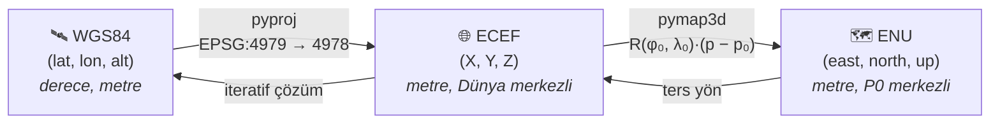

<div align="center">

# 🌍 Ders 1 · Geodesy ve Koordinat Sistemleri

**Faz 1** · ⏱️ ~3 saat · 📐 Matematik: ★★☆☆

[← Ders 0](00_big_picture.md) · [İçindekiler](README.md) · [Ders 2 →](02_data_and_simulation.md)

</div>

---

## 🎯 Öğrenme hedefleri

- [ ] WGS84 ellipsoid'ini ve **latitude / longitude / altitude**'un geometrik anlamını açıklamak
- [ ] Geodetic → **ECEF** → **ENU** dönüşümünü formülüyle yazmak
- [ ] Bir **rotation matrix**'in özelliklerini ve **Euler angles** / **quaternion** temsillerini bilmek
- [ ] **SE(3)** homojen dönüşümleriyle çalışmak
- [ ] Bir **covariance**'ı bir frame'den diğerine taşımak: $\boldsymbol{\Sigma}' = \mathbf{R}\boldsymbol{\Sigma}\mathbf{R}^\top$
- [ ] Bu fazın kodunu ve testlerini kendi başına yazmak

---

## 💡 1. Neden koordinat dönüşümüyle başlıyoruz?

GNSS sana `(49.0153°, 8.4339°, 116 m)` gibi bir şey verir. Ama:

- IMU ölçümleri **metre/saniye²** cinsinden.
- Kamera hareketi **metre** cinsinden.
- Fizik denklemleri ($\mathbf{p} = \mathbf{p}_0 + \mathbf{v}t$) düz, metrik bir uzay ister.

Derece cinsinden enlem/boylamla doğrudan fizik yapamazsın: 1° boylam ekvatorda ≈ 111 km iken
Karlsruhe'de (49° K) ≈ 73 km'dir. Bu yüzden her şeyi önce **yerel, düz, metrik** bir frame'e
taşırız: **ENU** (East-North-Up).



---

## 📐 2. WGS84 ellipsoid'i

Dünya bir küre değil, kutuplarda basık bir **ellipsoid**'dir. GNSS'in kullandığı referans
ellipsoid **WGS84**'tür:

| Parametre | Değer | Anlamı |
|---|---|---|
| $a$ | 6 378 137.0 m | Ekvator yarıçapı (**semi-major axis**) |
| $f$ | 1 / 298.257223563 | Basıklık (**flattening**) |
| $b = a(1-f)$ | ≈ 6 356 752.3 m | Kutup yarıçapı |
| $e^2 = f(2-f)$ | ≈ 0.00669438 | Birinci **eccentricity**'nin karesi |

> [!NOTE]
> **Latitude** $\varphi$, ellipsoid yüzeyine dik olan normalin ekvator düzlemiyle yaptığı açıdır
> (**geodetic latitude**). Dünya merkezine çizilen çizginin açısı değildir. Basıklık yüzünden
> bu ikisi 0.19°'ye kadar farklıdır.

---

## 📐 3. Geodetic → ECEF

**ECEF** (Earth-Centered, Earth-Fixed): orijini Dünya'nın kütle merkezinde, Z ekseni kuzey
kutbuna, X ekseni 0° boylam ile ekvatorun kesişimine bakan, Dünya'yla birlikte dönen kartezyen
sistem.

Önce **prime vertical radius of curvature** (o enlemdeki yerel eğrilik yarıçapı):

$$
N(\varphi) = \frac{a}{\sqrt{1 - e^2 \sin^2\varphi}}
$$

Sonra dönüşüm:

$$
\boxed{
\begin{aligned}
X &= (N + h)\cos\varphi\cos\lambda \\
Y &= (N + h)\cos\varphi\sin\lambda \\
Z &= \big(N(1 - e^2) + h\big)\sin\varphi
\end{aligned}
}
$$

Burada $\lambda$ longitude, $h$ ellipsoid üzerindeki yükseklik (**ellipsoidal height**).

**Ters yön (ECEF → geodetic)** kapalı formda çözülemez, çünkü $N$ de $\varphi$'ye bağlıdır.
Kütüphaneler bunu iteratif olarak (Bowring yöntemi gibi) birkaç adımda nanometre hassasiyetine
kadar çözer. Bu yüzden projede bu iş [`pyproj`](https://pyproj4.github.io/pyproj/)'a bırakıldı.

> [!WARNING]
> **Ellipsoidal height** ile deniz seviyesinden yükseklik (**orthometric height**, MSL) farklıdır.
> Aradaki fark (**geoid undulation**) Türkiye'de ≈ 30–40 m'dir. KITTI'nin OXTS'i ellipsoid
> yüksekliği verir; karıştırırsan dikeyde onlarca metre hata yaparsın.

---

## 📐 4. ECEF → ENU

**ENU**, bir referans noktası $P_0$'da Dünya'ya teğet olan düzlemdir. Projede $P_0$ = **ilk
geçerli GNSS fix'i**. Dönüşüm iki adım: önce $P_0$'a göre fark al, sonra eksenleri döndür.

$$
\mathbf{p}_{\text{ENU}} = \mathbf{R}(\varphi_0, \lambda_0)\,\big(\mathbf{p}_{\text{ECEF}} - \mathbf{p}_{0,\text{ECEF}}\big)
$$

$$
\mathbf{R}(\varphi, \lambda) =
\begin{bmatrix}
-\sin\lambda & \cos\lambda & 0 \\
-\sin\varphi\cos\lambda & -\sin\varphi\sin\lambda & \cos\varphi \\
\cos\varphi\cos\lambda & \cos\varphi\sin\lambda & \sin\varphi
\end{bmatrix}
\begin{matrix} \leftarrow \text{East} \\ \leftarrow \text{North} \\ \leftarrow \text{Up} \end{matrix}
$$

**Bu matris nereden geliyor?** Her satırı, ECEF'te ifade edilmiş bir birim vektör:

- **Up**: ellipsoid normali. ECEF formülünde $(\cos\varphi\cos\lambda,\ \cos\varphi\sin\lambda,\ \sin\varphi)$ yönü.
- **East**: $\lambda$ artınca gidilen yön, yani $\partial \mathbf{p} / \partial \lambda$ normalize edilmiş: $(-\sin\lambda, \cos\lambda, 0)$.
- **North**: $\text{Up} \times \text{East}$.

💻 **Projede:** [geodesy.py:38](../../src/gnss_denied/core/geodesy.py#L38), `ecef_to_enu_rotation`.

### Düz Dünya varsayımı ne zaman bozulur?

ENU düzdür, Dünya değildir. $P_0$'dan $d$ kadar uzaklaştığında, teğet düzlem yüzeyden
yaklaşık şu kadar ayrılır:

$$
\Delta h \approx \frac{d^2}{2R_\oplus}
$$

| $d$ | $\Delta h$ |
|---|---|
| 100 m | 0.8 mm |
| 1 km | 7.8 cm |
| 10 km | 7.8 m |
| 100 km | 785 m |

Bu proje ≈ 1 km'lik bir sürüş kullanıyor, sorun yok. Ama dönüşüm her zaman tam ellipsoid
formülüyle yapıldığı için noktalar zaten doğru yerde; sadece "up" ekseni uzakta artık gerçek
dikey değil. Uzun menzilli bir drone için bu önemlidir.

---

## 📐 5. Rotation matrix ve SO(3)

ENU dönüşümündeki $\mathbf{R}$ bir **rotation matrix**'tir. Bütün rotasyonların kümesine
**SO(3)** (Special Orthogonal group) denir:

$$
SO(3) = \lbrace \mathbf{R} \in \mathbb{R}^{3\times3} \;:\; \mathbf{R}^\top\mathbf{R} = \mathbf{I},\ \det\mathbf{R} = +1 \rbrace
$$

Bu iki koşulun pratik sonuçları:

| Özellik | Sonuç |
|---|---|
| $\mathbf{R}^\top\mathbf{R} = \mathbf{I}$ | **Tersi = transpose'u**: $\mathbf{R}^{-1} = \mathbf{R}^\top$. Hesaplaması bedava. |
| | Uzunlukları ve açıları korur. |
| $\det\mathbf{R} = +1$ | Ayna yansıması değil, gerçek bir dönme. |
| 9 sayı, 6 kısıt | Aslında sadece **3 serbestlik derecesi** var. |

> [!TIP]
> Son satır, Ders 4'ün en önemli fikrine kapı açıyor: rotation'ı 9 sayıyla saklıyoruz ama
> optimizasyon yaparken sadece 3 sayıyla oynamalıyız. Bunun aracı **Lie algebra** ve `Exp` /
> `Log` haritalarıdır (Ders 3).

### Rotasyonu temsil etmenin üç yolu

| Temsil | Sayı | Artısı | Eksisi |
|---|---|---|---|
| **Euler angles** (roll, pitch, yaw) | 3 | İnsan okuyabilir | **Gimbal lock**, açı sıralaması karışıklığı |
| **Rotation matrix** | 9 | Çarpımı ve noktayı döndürmesi kolay | Fazladan sayı, sayısal olarak bozulabilir |
| **Quaternion** $(w, x, y, z)$ | 4 | Kompakt, gimbal lock yok, interpolasyonu kolay | Sezgisel değil; $q$ ve $-q$ aynı rotasyon |

#### Euler angles: ZYX (yaw-pitch-roll)

KITTI'nin OXTS'i ve GTSAM'in `Rot3.Ypr` fonksiyonu şu sırayı kullanır:

$$
\mathbf{R} = \mathbf{R}_z(\psi)\,\mathbf{R}_y(\theta)\,\mathbf{R}_x(\phi)
$$

$\psi$ = yaw (heading), $\theta$ = pitch, $\phi$ = roll. Örneğin z ekseni etrafında dönme:

$$
\mathbf{R}_z(\psi) = \begin{bmatrix} \cos\psi & -\sin\psi & 0 \\ \sin\psi & \cos\psi & 0 \\ 0 & 0 & 1 \end{bmatrix}
$$

💻 **Projede:** [factor_graph.py:75](../../src/gnss_denied/backend/factor_graph.py#L75),
`gtsam.Rot3.Ypr(self.yaw_rad, self.pitch_rad, self.roll_rad)`.

> [!WARNING]
> **Gimbal lock**: pitch = ±90° olduğunda yaw ve roll aynı eksene düşer ve bir serbestlik
> derecesi kaybolur. Araba için sorun değil, akrobatik bir drone için ciddi bir sorun. Bu yüzden
> içeride her zaman matris veya quaternion kullanılır, Euler sadece giriş/çıkışta.

#### Quaternion

$\mathbf{u}$ ekseni etrafında $\theta$ kadar dönme:

$$
q = \Big(\underbrace{\cos\tfrac{\theta}{2}}_{w},\ \underbrace{\sin\tfrac{\theta}{2}\,\mathbf{u}}_{(x,\,y,\,z)}\Big),
\qquad \lVert q \rVert = 1
$$

Projede quaternion'lar her zaman **wxyz** sırasıyla saklanır (`orientation_wxyz`,
`rotation_wxyz`). Bazı kütüphaneler (ROS, SciPy) **xyzw** kullanır. Bu sırayı karıştırmak,
navigasyon kodundaki en klasik hatalardan biridir.

---

## 📐 6. SE(3): rotation + translation

Bir **rigid body transform** (katı cisim dönüşümü) hem döndürür hem öteler. Bunu tek bir 4×4
matrisle yazarız (**homogeneous coordinates**):

$$
T = \begin{bmatrix} \mathbf{R} & \mathbf{t} \\ \mathbf{0}^\top & 1 \end{bmatrix} \in SE(3),
\qquad
T \begin{bmatrix} \mathbf{p} \\ 1 \end{bmatrix} = \begin{bmatrix} \mathbf{R}\mathbf{p} + \mathbf{t} \\ 1 \end{bmatrix}
$$

**Tersi** (çok sık lazım olacak):

$$
T^{-1} = \begin{bmatrix} \mathbf{R}^\top & -\mathbf{R}^\top\mathbf{t} \\ \mathbf{0}^\top & 1 \end{bmatrix}
$$

GTSAM'de bu tipin adı `Pose3`. 6 serbestlik derecesi var (3 rotation + 3 translation).

💻 **Projede:** [kitti_raw.py:37](../../src/gnss_denied/datasets/kitti_raw.py#L37),
`_rigid_transform`, ve kamera ile IMU arasındaki zincir
[kitti_raw.py:55](../../src/gnss_denied/datasets/kitti_raw.py#L55).

---

## 📐 7. Covariance propagation: belirsizliği taşımak

GNSS fix'i sadece bir konum değil, bir de **covariance** getirir: "kuzeyde 0.5 m, doğuda 0.5 m,
yukarıda 1 m belirsizim" gibi. Konumu döndürdüğünde belirsizliği de döndürmen gerekir.

### Lineer dönüşümler

$\mathbf{y} = \mathbf{A}\mathbf{x}$ ve $\mathbf{x}$'in covariance'ı $\boldsymbol{\Sigma}_x$ ise:

$$
\boxed{\boldsymbol{\Sigma}_y = \mathbf{A}\,\boldsymbol{\Sigma}_x\,\mathbf{A}^\top}
$$

**Neden?** Tanımdan: $\boldsymbol{\Sigma}_y = \mathbb{E}[\mathbf{y}\mathbf{y}^\top] = \mathbb{E}[\mathbf{A}\mathbf{x}\mathbf{x}^\top\mathbf{A}^\top] = \mathbf{A}\,\mathbb{E}[\mathbf{x}\mathbf{x}^\top]\,\mathbf{A}^\top$ (ortalaması sıfır varsayımıyla).

### Doğrusal olmayan dönüşümler

$\mathbf{y} = f(\mathbf{x})$ ise, $f$'i ortalama etrafında birinci dereceden açarız ve
$\mathbf{A}$ yerine **Jacobian** $\mathbf{J} = \partial f / \partial \mathbf{x}$ kullanırız:

$$
\boldsymbol{\Sigma}_y \approx \mathbf{J}\,\boldsymbol{\Sigma}_x\,\mathbf{J}^\top
$$

Bu, **EKF**'nin ve factor graph'ların ortak temelidir. Ders 3 ve 4'te sürekli göreceksin.

### Projede: teğet düzlemler paralel değil

Degrader, gürültüyü **fix'in kendi** ENU eksenlerinde üretir. Graph ise $P_0$'ın ENU eksenlerinde
çalışır. İki farklı noktadaki teğet düzlemler birbirine göre hafifçe dönmüştür. Doğru dönüşüm:

$$
\mathbf{R}_{P_0 \leftarrow \text{fix}} = \mathbf{R}(\varphi_0, \lambda_0)\;\mathbf{R}(\varphi, \lambda)^\top
$$

(Önce fix'in ENU'sundan ECEF'e, sonra ECEF'ten $P_0$'ın ENU'suna.) Ve covariance:

$$
\boldsymbol{\Sigma}_{P_0} = \mathbf{R}_{P_0 \leftarrow \text{fix}}\;\boldsymbol{\Sigma}_{\text{fix}}\;\mathbf{R}_{P_0 \leftarrow \text{fix}}^\top
$$

💻 **Projede:** [geodesy.py:105](../../src/gnss_denied/core/geodesy.py#L105), `rotate_covariance_from_fix`.

> [!NOTE]
> 1 km'de bu dönme açısı sadece $1/6371 \approx 1.6\times10^{-4}$ rad (≈ 0.009°). Etkisi küçük.
> Ama doğru yapmak bedava, yanlış yapmak ise uzun menzilde sessizce birikir. İyi navigasyon
> kodu bu tür "küçük" hataları bilerek kapatır.

---

## 💻 8. Bu fazın kodu

| Dosya | Görevi |
|---|---|
| [core/types.py](../../src/gnss_denied/core/types.py) | Bütün ölçüm tipleri: `ImuMeasurement`, `GnssMeasurement`, `StateOutput`... |
| [core/geodesy.py](../../src/gnss_denied/core/geodesy.py) | WGS84 ↔ ECEF ↔ ENU, `LocalEnuFrame` |
| [tests/test_geodesy.py](../../tests/test_geodesy.py) | Round-trip ve bilinen değer testleri |

### Tasarım kararları ve nedenleri

| Karar | Neden? |
|---|---|
| Tipler `@dataclass(frozen=True)` | Bir ölçüm üretildikten sonra değişmemeli. Yanlışlıkla değiştirilen bir array, günlerce aranan bir hatadır. |
| Array'ler salt okunur (`_frozen_array`) | `frozen=True` sadece alanı korur, array'in içini değil. |
| Covariance simetri kontrolü | Asimetrik bir covariance, upstream'de bir hata olduğunun işaretidir. Erken patlamak daha iyi. |
| Birim alan adında (`accel_mps2`, `alt_m`) | Birim hatası sessizdir. İsimde yazınca code review'da görünür. |
| `pyproj` + `pymap3d` | İkisi de aynı WGS84 ellipsoid'ini kullanır. Kendi formülünü yazmak öğreticidir ama üretim kodunda test edilmiş kütüphane güvenlidir. |
| `always_xy=True` | `pyproj` varsayılan olarak EPSG'nin eksen sırasını (lat, lon) kullanır. Bu bayrak sırayı (lon, lat) olarak sabitler. Klasik bir tuzak. |

### 🐞 Bir float tuzağı: neden ECEF'te çalışmıyoruz?

ECEF koordinatları ≈ $6.4\times10^6$ m büyüklüğündedir. `float32`'nin mantissa'sı 24 bit
olduğundan, $2^{22}$ ile $2^{23}$ (≈ 4.2–8.4 milyon) arasındaki sayılarda iki komşu değer arası
**0.5 m**'dir. Yani `float32` ile ECEF'te yarım metreden ince bir şey ifade edemezsin! ENU'da
koordinatlar küçük (yüzlerce metre) olduğu için hassasiyet mikrometre seviyesindedir. Projede her
şey `float64` ama yerel frame alışkanlığı GPU'da veya gömülü sistemde hayat kurtarır.

---

## 🧪 Alıştırmalar

**1.** $\varphi = 0°, \lambda = 0°, h = 0$ noktasının ECEF koordinatı nedir? $\varphi = 90°$ için?

<details>
<summary>Çözüm</summary>

- $\varphi = 0$: $N = a$, yani $(a, 0, 0) = (6\,378\,137, 0, 0)$.
- $\varphi = 90°$: $N = a/\sqrt{1-e^2}$, $Z = N(1-e^2) = a\sqrt{1-e^2} = b$. Yani $(0, 0, 6\,356\,752.3)$, kutup yarıçapı. Formül doğru çalışıyor.

</details>

**2.** `ecef_to_enu_rotation` matrisinin gerçekten SO(3)'te olduğunu `numpy` ile doğrula.

<details>
<summary>Çözüm</summary>

```python
import numpy as np
from gnss_denied.core.geodesy import ecef_to_enu_rotation

R = ecef_to_enu_rotation(49.0, 8.4)
assert np.allclose(R.T @ R, np.eye(3))
assert np.isclose(np.linalg.det(R), 1.0)
```

</details>

**3.** Fix'in ENU'sunda covariance $\text{diag}(0.25, 0.25, 1.0)$. Bunu bir 90° yaw rotasyonuyla
döndürürsen ne olur? Neden yatay kısım değişmez?

<details>
<summary>Çözüm</summary>

$\mathbf{R}_z(90°)$ east ile north'u yer değiştirir. Yeni covariance yine $\text{diag}(0.25, 0.25, 1.0)$
olur, çünkü yatay belirsizlik **izotropik** (her yönde eşit, bir daire). Daireyi döndürmek onu
değiştirmez. Covariance $\text{diag}(1, 0.25, 1)$ gibi bir elips olsaydı eksenler yer değiştirirdi.

</details>

**4. (Kod)** `LocalEnuFrame` kullanarak bir round-trip testi yaz: rastgele 1000 nokta üret,
ENU'ya ve geri çevir, maksimum hatanın 1 mm'den küçük olduğunu doğrula. Proje bu testte ≈ 9 nm
elde ediyor.

<details>
<summary>İpucu</summary>

$P_0$'dan birkaç km içinde rastgele `(east, north, up)` üret, `to_geodetic` ile WGS84'e, sonra
`from_geodetic` ile geri çevir. Karşılaştırmayı metre cinsinden yap, derece cinsinden değil.
[tests/test_geodesy.py](../../tests/test_geodesy.py)'deki yaklaşımla karşılaştır.

</details>

---

## ✅ Kendini kontrol et

- Geodetic latitude ile Dünya merkezine göre açı neden farklı?
- ENU matrisinin "Up" satırı neden ECEF formülündeki $(\cos\varphi\cos\lambda, \cos\varphi\sin\lambda, \sin\varphi)$'ye eşit?
- Bir rotation matrix'in tersini neden hesaplamana gerek yok?
- $\boldsymbol{\Sigma}_y = \mathbf{A}\boldsymbol{\Sigma}_x\mathbf{A}^\top$ formülünü türetebiliyor musun?
- Quaternion'ı **wxyz** mi **xyzw** mi sakladığını bilmek neden kritik?

<div align="center">

[← Ders 0](00_big_picture.md) · [İçindekiler](README.md) · **[Ders 2 · Veri ve simülasyon →](02_data_and_simulation.md)**

</div>
