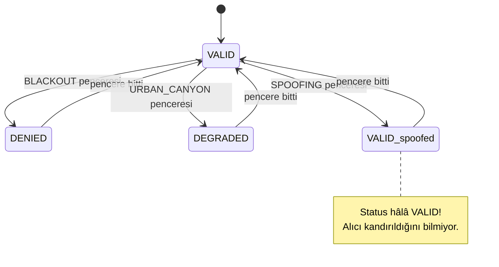

<div align="center">

# 📦 Ders 2 · Veri ve Sensör Simülasyonu

**Faz 2** · ⏱️ ~3 saat · 📐 Matematik: ★★☆☆

[← Ders 1](01_geodesy_and_frames.md) · [İçindekiler](README.md) · [Ders 3 →](03_imu_and_dead_reckoning.md)

</div>

---

## 🎯 Öğrenme hedefleri

- [ ] KITTI Raw'un yapısını ve OXTS'in neden hem **sensör** hem **ground truth** olduğunu açıklamak
- [ ] Bozuk zaman damgalarını **longest increasing subsequence** ile temizlemek
- [ ] Farklı hızdaki sensör akışlarını tek bir zaman eksenine **merge** etmek
- [ ] GNSS hatalarını Gaussian, **Cauchy** ve **ramp** modelleriyle simüle etmek
- [ ] IMU gürültüsünü **noise density** ve **bias random walk** cinsinden tanımlamak ve ayrık zamana çevirmek
- [ ] Datasheet'teki birimleri (µg/√Hz, °/√h, °/h) SI birimlerine çevirmek

---

## 💡 1. Neden donanım yerine açık veri + simülasyon?

Gerçek bir GNSS-denied testi pahalı ve tekrar edilemez: aracı tünele sokarsın, bir kez veri
alırsın, hepsi bu. Bu projenin yaklaşımı:

> **Gerçek sensör verisini al, GNSS'i yazılımla boz.**

Avantajları:

| Avantaj | Açıklama |
|---|---|
| 🎯 **Ground truth var** | KITTI'deki OXTS, RTK düzeltmeli GPS/INS: santimetre seviyesinde doğru. |
| 🔁 **Tekrarlanabilir** | Aynı seed → aynı gürültü → aynı sonuç. |
| 🎛️ **Kontrol edilebilir** | Blackout'u 30–90 s arasına koy, 60 s yap, 120 s yap. Hepsi bir YAML satırı. |
| 🎲 **Monte Carlo** | Seed'i değiştirerek aynı senaryoyu 8 farklı gürültüyle çalıştırabilirsin (Ders 6). |

---

## 📦 2. KITTI Raw ve OXTS

**KITTI**, Karlsruhe'de bir araçla kaydedilmiş, otonom sürüş araştırmalarının klasik veri
setidir. Bu proje `2011_09_30_drive_0018` sürüşünü kullanıyor.

| Akış | Kaynak | Hız | Ne için? |
|---|---|---|---|
| **OXTS** (`extract` seti) | OXTS RT3003 GPS/INS | 100 Hz | IMU ölçümü **ve** ground truth |
| **Stereo grayscale** (`sync` seti) | 2 × Point Grey kamera, 0.54 m arayla | ≈ 9.6 Hz | Visual odometry |

**OXTS** tek bir cihaz ama iki rol oynuyor:

- İçindeki **ham** ivme ve açısal hız alanları → bizim **IMU** ölçümümüz.
- RTK ile düzeltilmiş konum ve yönelim → bizim **ground truth**'umuz ve GNSS simülatörünün girdisi.

Her OXTS paketi 30 sayılık bir satırdır. Projede kullanılan alanlar:

| İndeks | Alan | Kullanım |
|---|---|---|
| 0–2 | `lat`, `lon`, `alt` | Truth konumu |
| 3–5 | `roll`, `pitch`, `yaw` | Truth yönelimi |
| 6, 7, 10 | `vn`, `ve`, `vu` | Truth hızı (ENU'ya çevrilirken sırası değişir: `(ve, vn, vu)`) |
| 11–13 | `ax`, `ay`, `az` | IMU accelerometer (body frame) |
| 17–19 | `wx`, `wy`, `wz` | IMU gyroscope (body frame) |

💻 **Projede:** [kitti_raw.py:160](../../src/gnss_denied/datasets/kitti_raw.py#L160) (`imu`) ve
[kitti_raw.py:166](../../src/gnss_denied/datasets/kitti_raw.py#L166) (`ground_truth`).

> [!WARNING]
> **Bir truth, iki kullanım = gizli korelasyon.** IMU ve truth aynı cihazdan geliyor. Gerçek bir
> sistemde IMU'nun truth'u "bildiği" böyle bir bağ yoktur. Proje bu yüzden `mems` profilinde
> IMU'ya ek gürültü basıyor (bölüm 6), böylece IMU daha ucuz, bağımsız bir sensör gibi davranıyor.

### 💡 28 GB yerine 1.5 GB: HTTP Range ile seçici indirme

KITTI arşivleri büyük ZIP dosyaları. Ama ZIP formatının güzel bir özelliği var: dosyanın
**sonunda** bir **central directory** bulunur, içinde her dosyanın adı ve arşivdeki konumu
yazar. Bu yüzden:

1. HTTP `Range` başlığıyla sadece son birkaç KB'yi indir → central directory'yi oku.
2. Gerekli dosyaları seç (örneğin sadece `image_00` ve `image_01`, lidar değil).
3. Her dosya için sadece onun byte aralığını indir, aç, **CRC32** ile doğrula.

💻 **Projede:** [data/download_sample.py](../../data/download_sample.py). `--dry-run` ile ne
indireceğini önceden görebilirsin. Güvenlik notu: arşivdeki dosya adları `../` içerebilir
(**path traversal**), `select_members` bunları reddeder.

---

## 📐 3. Bozuk zaman damgaları ve LIS algoritması

Ham OXTS kayıtlarında bazı paketler yanlış zaman damgasıyla gelir. Sürüş 0018'de bazı paket
grupları **60 ms geç** damgalanmış. Zaman geri giderse, IMU entegrasyonunda $\Delta t < 0$ olur
ve her şey bozulur.

### 🐞 Gerçek hata: naif filtre iyi paketleri atıyordu

İlk deneme: "bir öncekinden küçük damgayı at". Sayıları sadeleştirelim:

```text
damgalar:     1  2  3  9  10  4  5  6  7  11
                       ^^^^^  geç damgalanmış iki paket
naif filtre:  1  2  3  9  10              11     → 4 iyi paket atıldı ❌
LIS:          1  2  3        4  5  6  7  11      → 2 kötü paket atıldı ✅
```

Naif filtre ilk gördüğü sıçramaya güvenir ve arkasından gelen doğru paketleri "geri gitti"
diye atar. Çözüm: **en uzun artan alt diziyi** (**longest increasing subsequence**, LIS) tut.
Bu, sıralamayı bozan en az paketi atar ve ileri/geri sıçramaları aynı şekilde ele alır.

Sürüş 0018'de bu değişiklik atılan paket sayısını 12'den 8'e düşürdü.

### 📐 Algoritma: $O(n \log n)$ patience sorting

Her uzunluk $k$ için "uzunluğu $k$ olan artan dizinin bitebileceği en küçük değeri" tutarız
(`tail_values`). Her yeni değer için binary search ile yerini buluruz:

```python
position = bisect_left(tail_values, value)   # O(log n)
```

- `position == len(tail_values)` ise en uzun diziyi uzatır.
- Değilse, o uzunluktaki dizinin sonunu daha küçük bir değerle değiştirir (gelecek için daha iyi).

Sonunda `predecessors` dizisinden geriye yürüyerek indisleri çıkarırız.

💻 **Projede:** [kitti_raw.py:79](../../src/gnss_denied/datasets/kitti_raw.py#L79), `_longest_increasing_indices`.

---

## 📐 4. Akışları birleştirmek: k-way merge

Elimizde üç ayrı, kendi içinde sıralı akış var: IMU (100 Hz), kamera (≈ 9.6 Hz), GNSS (1 Hz).
Back-end'e bunları **gerçek zamanda gelecekleri sırayla** vermeliyiz.

```text
zaman (s)   0.00  0.01  0.02  ...  0.10  0.11  ...  0.21  ...  1.00
IMU         ●     ●     ●     ...  ●     ●     ...  ●     ...  ●        100 Hz
Kamera                               ■                ■                  ≈ 9.6 Hz
GNSS        ▲                                                   ▲        1 Hz
                                     │
merge →     ● ● ● ... ● ■ ● ... ● ■ ... ▲   (tek, zaman sıralı akış)
```

Bu, klasik bir **k-way merge** problemidir. Python'un `heapq.merge`'i bunu bir **min-heap** ile
$O(N \log k)$'da yapar ($N$ toplam paket, $k$ akış sayısı) ve bütün akışı belleğe almaz
(**lazy**, generator).

Aynı zaman damgasına sahip iki paket varsa (**tie**), argüman sırası korunur. Projede
`merge_streams(imu, odometry, gnss)` sırası bilinçli: aynı anda gelirse önce IMU entegre edilir,
sonra kamera, en son GNSS.

💻 **Projede:** [core/streams.py](../../src/gnss_denied/core/streams.py) ve kullanıldığı yer
[pipeline.py:119](../../src/gnss_denied/pipeline.py#L119).

---

## 📐 5. GNSS degrader: üç arıza modu

Degrader, 100 Hz truth'u alır, **1 Hz**'e indirir ve her epoch'a gürültü ekler. Aktif bir
**degradation window** varsa onun modunu uygular.



### 5.1 Normal durum: Gaussian gürültü

$$
\mathbf{z}_{\text{ENU}} = \mathbf{p}_{\text{true}} + \boldsymbol{\eta},
\qquad
\boldsymbol{\eta} \sim \mathcal{N}\big(\mathbf{0},\ \text{diag}(\sigma_h^2, \sigma_h^2, \sigma_v^2)\big)
$$

Projede $\sigma_h = 0.5$ m, $\sigma_v = 1.0$ m. Dikey hatanın yatayın iki katı olması gerçekçi:
uydular hep yukarıda, aşağıdan uydu görmüyorsun, bu yüzden dikey geometri zayıf (**VDOP > HDOP**).

**Yatay hata ne kadar büyük?** İki bağımsız $\mathcal{N}(0, \sigma^2)$ bileşenin büyüklüğü
$r = \sqrt{\eta_E^2 + \eta_N^2}$ bir **Rayleigh** dağılımı izler:

| İstatistik | Formül | $\sigma_h = 0.5$ m için |
|---|---|---|
| Medyan (**CEP**, %50) | $\sigma\sqrt{2\ln 2} \approx 1.177\,\sigma$ | 0.59 m |
| %95 | $\sigma\sqrt{-2\ln 0.05} \approx 2.448\,\sigma$ | 1.22 m |

### 5.2 `BLACKOUT`: hiç fix yok

Konum `NaN`, covariance $\infty \cdot \mathbf{I}$, status `DENIED`. "Sonsuz covariance" =
"sıfır information": ölçüm graph'a hiçbir şey eklemez. Back-end bu epoch'ta sadece keyframe açar.

### 5.3 `URBAN_CANYON`: ağır kuyruklu sıçramalar

Binalardan yansıyan sinyal (**multipath**) çoğu zaman küçük, ama arada bir çok büyük hata verir.
Gaussian bunu modelleyemez çünkü kuyrukları çok hızlı söner. Bunun yerine **Cauchy** dağılımı:

$$
p(x) = \frac{1}{\pi\gamma\left(1 + (x/\gamma)^2\right)}
$$

| | Gaussian | Cauchy |
|---|---|---|
| Kuyruk | $e^{-x^2}$ gibi söner | $1/x^2$ gibi söner (çok yavaş) |
| Mean | Var | **Tanımsız** |
| Variance | Var | **Sonsuz** |
| $\lvert x \rvert > 20\gamma$ olasılığı | ≈ 0 | ≈ %3.2 |

Son satırın hesabı: $P(\lvert x\rvert > k\gamma) = 1 - \frac{2}{\pi}\arctan(k)$. $k = 20$ için
$1 - 0.968 = 0.032$.

Projede $\gamma = 5$ m ve sıçramalar ±100 m'de kırpılıyor (yani $k = 20$). Kırpılmasa, Cauchy
bazen binlerce kilometrelik değerler üretir; hiçbir alıcı böyle bir şey raporlamaz.
Covariance 25 kat şişirilir, status `DEGRADED` olur.

> [!IMPORTANT]
> Cauchy'nin **variance'ı sonsuz** olduğu için, Gaussian varsayan bir estimator (least squares)
> bu ölçümlerden birine aşırı güvenebilir. Ders 5'te göreceğin **robust kernel**'lar (Huber,
> Cauchy) tam olarak bu problemi çözer.

### 5.4 `SPOOFING`: sessiz kayma

Pencere başladığından beri geçen süreyle doğrusal büyüyen bir kayma:

$$
\mathbf{z}(t) = \mathbf{p}_{\text{true}}(t) + \boldsymbol{\eta} + v_s\,(t - t_0)\,\begin{bmatrix}\sin\beta \\ \cos\beta \\ 0\end{bmatrix}
$$

$\beta$ **bearing** (kuzeyden saat yönünde açı), $v_s$ kayma hızı. Projede $v_s = 1$ m/s,
$\beta = 90°$ (doğuya). **Status `VALID` kalır, covariance normal kalır.** Akıllı bir saldırgan
yavaş kaydırır; her fix bir öncekinden sadece 1 m farklıdır ve tek başına şüpheli görünmez.

💻 **Projede:** [gnss_degrader.py:115](../../src/gnss_denied/simulator/gnss_degrader.py#L115), `_measure`.

### 💡 Tasarım detayı: gürültü her epoch'ta çekilir

```python
gaussian = rng.standard_normal(3)
cauchy = rng.standard_cauchy(2)
yield self._measure(sample, gaussian, cauchy)
```

Blackout epoch'unda gürültü kullanılmasa bile **çekilir**. Neden? Böylece blackout penceresini
kaydırdığında, pencere dışındaki epoch'lar **aynı** gürültüyü görür. İki senaryoyu
karşılaştırırken fark sadece senaryodan gelir, şanstan değil. İstatistikte bunun adı
**common random numbers** (varyans azaltma tekniği).

---

## 📐 6. IMU gürültü modeli

Bu kursun en önemli modellerinden biri. Ders 3 ve 4 tamamen bunun üstüne kurulu.

### 6.1 Ölçüm modeli

$$
\begin{aligned}
\tilde{\mathbf{a}}(t) &= \mathbf{a}(t) + \mathbf{b}_a(t) + \mathbf{n}_a(t) \\
\tilde{\boldsymbol{\omega}}(t) &= \boldsymbol{\omega}(t) + \mathbf{b}_g(t) + \mathbf{n}_g(t) \\
\dot{\mathbf{b}}_a(t) &= \mathbf{n}_{ba}(t), \qquad \dot{\mathbf{b}}_g(t) = \mathbf{n}_{bg}(t)
\end{aligned}
$$

| Terim | Adı | Davranışı |
|---|---|---|
| $\mathbf{n}_a, \mathbf{n}_g$ | **White noise** | Her örnekte bağımsız titreşim |
| $\mathbf{b}_a, \mathbf{b}_g$ | **Bias** | Yavaş değişen sabit kayma; asıl düşman bu |
| $\mathbf{n}_{ba}, \mathbf{n}_{bg}$ | **Bias random walk** sürücüsü | Bias'ın zamanla gezinmesi |
| $\mathbf{b}(0)$ | **Turn-on bias** | Cihaz her açıldığında farklı bir başlangıç bias'ı |

### 6.2 Noise density: neden birimi $\sqrt{\text{Hz}}$?

Datasheet'ler gürültüyü **sürekli zamanda** verir, örneğin accelerometer için
$\sigma_c$ = 0.002 m/s²/√Hz. Bunun nedeni, gürültünün standart sapmasının **örnekleme hızına
bağlı** olmasıdır: daha hızlı örneklersen, her örnek daha az ortalama yaptığı için daha gürültülü
görünür.

Sürekli → ayrık dönüşüm ($\Delta t$ örnekleme aralığı):

$$
\boxed{
\sigma_{d}^{\text{white}} = \frac{\sigma_c}{\sqrt{\Delta t}}
\qquad\qquad
\sigma_{d}^{\text{bias step}} = \sigma_{c,b}\,\sqrt{\Delta t}
}
$$

**Sezgi:** White noise'u $\Delta t$ boyunca entegre edersen, hızdaki hata $\sigma_c\sqrt{\Delta t}$
kadar büyür (bağımsız adımların toplamı). Bunu bir tek örnek gibi görmek istiyorsan, örneğin
kendisinin $\sigma_c\sqrt{\Delta t} / \Delta t = \sigma_c / \sqrt{\Delta t}$ olması gerekir.
Random walk ise her adımda $\sqrt{\Delta t}$ ile orantılı büyür (Brown hareketi).

100 Hz'de ($\Delta t = 0.01$ s) $\sigma_c = 0.002$ → $\sigma_d = 0.02$ m/s². Yani her örnek
≈ 2 mg titreşiyor.

💻 **Projede:** [imu_degrader.py:30](../../src/gnss_denied/simulator/imu_degrader.py#L30),
`corrupt_imu`. Formüller docstring'de ve satır 49–54'te birebir.

### 6.3 Datasheet birimlerinden SI'ya

Datasheet'ler tuhaf birimler kullanır. `configs/default_sim.yaml`'daki `mems` profilinin
yorum satırı: *"200 µg/√Hz, 0.7 °/√h, 3 mg and 100 °/h turn-on"*. Çevirelim
($g$ = 9.81 m/s²):

| Datasheet | Hesap | SI | YAML'daki değer |
|---|---|---|---|
| 200 µg/√Hz | $200\times10^{-6}\times 9.81$ | 1.96e-3 m/s²/√Hz | `2.0e-3` ✅ |
| 0.7 °/√h (**ARW**) | $0.7 \times \frac{\pi}{180} / \sqrt{3600}$ | 2.04e-4 rad/s/√Hz | `2.0e-4` ✅ |
| 3 mg turn-on | $3\times10^{-3}\times 9.81$ | 0.0294 m/s² | `0.03` ✅ |
| 100 °/h turn-on | $100 \times \frac{\pi}{180} / 3600$ | 4.85e-4 rad/s | `5.0e-4` ✅ |

**ARW** (Angle Random Walk): gyro white noise'unun açı cinsinden etkisi. 0.7 °/√h, 1 saatte
açıda ≈ 0.7° belirsizlik demek.

> [!TIP]
> Bu parametreleri gerçek bir IMU için nasıl bulursun? Cihazı saatlerce sabit bırak, kayıt al,
> **Allan variance** grafiğini çiz. Eğimi −1/2 olan bölge white noise'u, eğimi +1/2 olan bölge
> bias random walk'u, düz dip noktası **bias instability**'yi verir. Projede yok, ama bir
> sonraki adım olarak harika bir alıştırma.

### 6.4 İki profil: `raw` ve `mems`

| Profil | Ne yapıyor? | Neden? |
|---|---|---|
| `raw` | OXTS'i olduğu gibi kullanır | OXTS navigasyon sınıfı bir cihaz, ucuz bir drone'unkinden çok iyi |
| `mems` | Üstüne MEMS gürültüsü ekler | Gerçekçi, ucuz bir platformu temsil eder; drift'i belirgin hale getirir |

Her profilde iki ayrı blok var ve bu ayrım önemli:

- `injected`: **gerçekte** eklenen gürültü (simülasyon).
- `estimator`: estimator'ın **varsaydığı** gürültü (Ders 4).

Estimator değerleri bilerek biraz daha büyük seçildi, çünkü araç hareket ederken titreşim, saf
sensör gürültüsünden baskındır. Gerçek hayatta da sensörün gürültüsünü hiçbir zaman tam bilmezsin.

---

## 🧪 Alıştırmalar

**1.** `[5, 1, 2, 8, 3, 4, 9]` dizisi için naif filtre ve LIS hangi elemanları tutar?

<details>
<summary>Çözüm</summary>

- Naif ("öncekinden küçükse at"): `5, 8, 9` tutulur. 4 eleman atılır.
- LIS: `1, 2, 3, 4, 9` (uzunluk 5). Sadece `5` ve `8` atılır. LIS ilk elemana bile güvenmez.

</details>

**2.** $\gamma = 5$ m'lik Cauchy sıçramalarında, sıçramaların yüzde kaçı 10 m'den büyüktür?
Gaussian $\sigma = 5$ m için aynı oran nedir?

<details>
<summary>Çözüm</summary>

- Cauchy, $k = 2$: $1 - \frac{2}{\pi}\arctan 2 = 1 - 0.705 = 0.295$ → **%29.5**
- Gaussian, $2\sigma$: **%4.6**

Cauchy'de büyük hatalar Gaussian'dakinden 6 kat daha sık.

</details>

**3.** Bir gyro'nun datasheet'inde ARW = 0.15 °/√h ve bias instability = 10 °/h yazıyor. Bunları
rad/s/√Hz ve rad/s cinsinden yaz.

<details>
<summary>Çözüm</summary>

- ARW: $0.15 \times 0.017453 / 60 = 4.36\times10^{-5}$ rad/s/√Hz
- Bias: $10 \times 0.017453 / 3600 = 4.85\times10^{-5}$ rad/s

</details>

**4. (Kod)** `corrupt_imu`'yu sabit duran bir IMU'ya (bütün örnekler sıfır) 1 saat uygula. Gyro
çıktısını entegre et ve açı hatasının zamanla nasıl büyüdüğünü çiz. $\sqrt{t}$ ile mi, $t$ ile mi
büyüyor? Hangi terim hangisinden sorumlu?

<details>
<summary>İpucu</summary>

White noise'un integrali $\sqrt{t}$ ile büyür (ARW). Sabit turn-on bias'ın integrali $t$ ile
büyür. Bias random walk'un integrali $t^{3/2}$ ile büyür. Log-log grafikte eğimler 0.5, 1 ve 1.5
olur. Kısa sürede hangisinin baskın olduğuna dikkat et.

</details>

---

## ✅ Kendini kontrol et

- OXTS'in aynı anda IMU ve truth olması neden bir risk, proje bunu nasıl yumuşatıyor?
- LIS neden naif filtreden daha az paket atar?
- Cauchy'nin variance'ı sonsuzsa, neden yine de bir "scale" parametresi var?
- Spoofing neden blackout'tan daha tehlikeli?
- $\sigma_d = \sigma_c / \sqrt{\Delta t}$ formülünü sezgisel olarak açıklayabilir misin?

<div align="center">

[← Ders 1](01_geodesy_and_frames.md) · [İçindekiler](README.md) · **[Ders 3 · IMU ve dead reckoning →](03_imu_and_dead_reckoning.md)**

</div>
