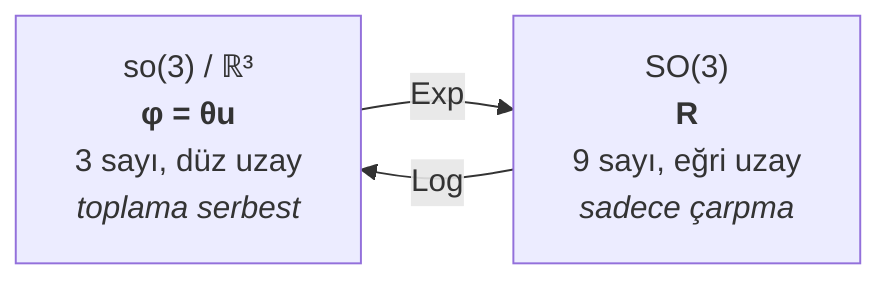
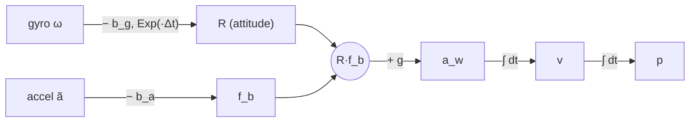
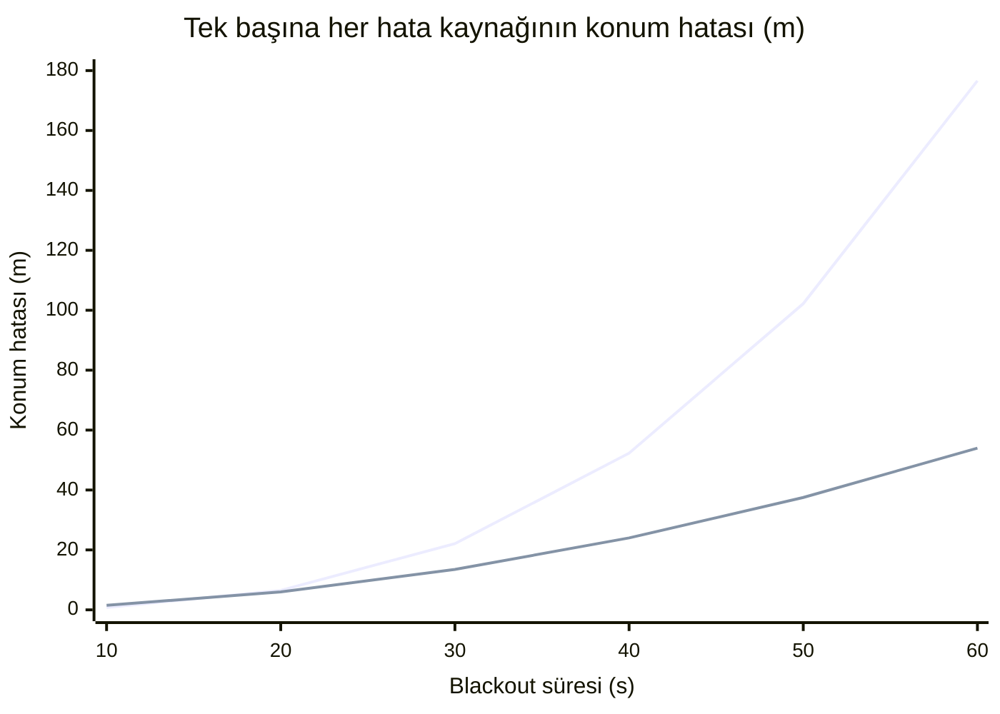

<div align="center">

# ⚙️ Ders 3 · IMU ve Dead Reckoning

**Faz 3 (a)** · ⏱️ ~4 saat · 📐 Matematik: ★★★☆

[← Ders 2](02_data_and_simulation.md) · [İçindekiler](README.md) · [Ders 4 →](04_factor_graphs_and_gtsam.md)

</div>

---

## 🎯 Öğrenme hedefleri

- [ ] Accelerometer'ın neden ivmeyi değil **specific force**'u ölçtüğünü açıklamak
- [ ] **Strapdown** kinematik denklemlerini sürekli ve ayrık zamanda yazmak
- [ ] **Skew-symmetric** matris, **so(3)**, `Exp` ve `Log` haritalarını kullanmak
- [ ] Bias'ın konum hatasını neden $t^2$ ve hatta $t^3$ ile büyüttüğünü türetmek
- [ ] Projedeki `DeadReckoner` sınıfını ve **first-order hold**'u anlamak
- [ ] Roll ve pitch'i sabit duran bir IMU'dan hesaplamak (**initial alignment**)

---

## 💡 1. IMU aslında neyi ölçüyor?

Bir **IMU** (Inertial Measurement Unit) iki sensörden oluşur:

| Sensör | Ölçtüğü | Birim |
|---|---|---|
| **Gyroscope** | Body frame'in açısal hızı $\boldsymbol{\omega}$ | rad/s |
| **Accelerometer** | **Specific force** $\mathbf{f}$ (ivme değil!) | m/s² |

### Specific force nedir?

Accelerometer içinde yayla asılı küçük bir kütle düşün. Sensör yayın gerginliğini ölçer.

- Masada sabit dururken: kütle yerçekimiyle aşağı çekilir, yay gerilir. Sensör **+9.81 m/s² yukarı**
  okur. Ama ivmen sıfır!
- Serbest düşüşte: kütle ve kutu birlikte düşer, yay gerilmez. Sensör **0** okur. Ama ivmen 9.81!

Yani accelerometer, **yerçekimi dışındaki** kuvvetlerden gelen ivmeyi ölçer:

$$
\boxed{\mathbf{f}_b = \mathbf{R}^\top\,(\mathbf{a}_w - \mathbf{g}_w)}
\qquad\Longleftrightarrow\qquad
\mathbf{a}_w = \mathbf{R}\,\mathbf{f}_b + \mathbf{g}_w
$$

Burada $\mathbf{R} = \mathbf{R}_{wb}$ body'den world'e rotation, ENU'da
$\mathbf{g}_w = (0,\ 0,\ -9.809)$ m/s².

💻 **Projede:** [factor_graph.py:8](../../src/gnss_denied/backend/factor_graph.py#L8) docstring'i
tam bunu söylüyor: *"an accelerometer at rest reads +g on z"*. GTSAM'deki
`PreintegrationParams.MakeSharedU(g)`'deki **U** = "Up": z ekseni yukarı, yerçekimi $-z$ yönünde.
(NED kullanan sistemler için `MakeSharedD` var.)

> [!WARNING]
> **Navigasyondaki en kritik nokta:** $\mathbf{a}_w = \mathbf{R}\mathbf{f}_b + \mathbf{g}_w$
> formülünde $\mathbf{g}$'yi çıkarmak için $\mathbf{R}$'yi bilmen gerekiyor. $\mathbf{R}$'de küçük
> bir hata, 9.81 m/s²'lik devasa yerçekiminin bir kısmının **yatay ivme gibi görünmesine** yol
> açar. Bölüm 5'te bunun neden felaket olduğunu hesaplayacağız.

---

## 📐 2. Rotasyon kinematiği: so(3), Exp ve Log

### Skew-symmetric matris (**hat operator**)

Bir vektörle cross product'ı matris çarpımı olarak yazmanın yolu:

$$
\boldsymbol{\omega}^\wedge = [\boldsymbol{\omega}]_\times =
\begin{bmatrix} 0 & -\omega_z & \omega_y \\ \omega_z & 0 & -\omega_x \\ -\omega_y & \omega_x & 0 \end{bmatrix},
\qquad
[\boldsymbol{\omega}]_\times\,\mathbf{v} = \boldsymbol{\omega}\times\mathbf{v}
$$

Bütün skew-symmetric 3×3 matrislerin kümesine **so(3)** denir: SO(3)'ün **Lie algebra**'sı.
Ters işlem (matristen vektöre) **vee** operatörüdür: $(\cdot)^\vee$.

### Rotasyonun türevi

Body açısal hızı $\boldsymbol{\omega}$ ile dönen bir cismin rotasyonu:

$$
\dot{\mathbf{R}} = \mathbf{R}\,[\boldsymbol{\omega}]_\times
$$

$\boldsymbol{\omega}$ bir $\Delta t$ boyunca sabitse, bu diferansiyel denklemin **tam** çözümü
matris üstelidir:

$$
\mathbf{R}(t + \Delta t) = \mathbf{R}(t)\,\text{Exp}(\boldsymbol{\omega}\,\Delta t)
$$

### Exp haritası: Rodrigues formülü

$\boldsymbol{\phi} = \theta\,\mathbf{u}$ ($\theta = \lVert\boldsymbol{\phi}\rVert$, $\mathbf{u}$ birim eksen) için:

$$
\boxed{
\text{Exp}(\boldsymbol{\phi}) = \mathbf{I} + \frac{\sin\theta}{\theta}\,[\boldsymbol{\phi}]_\times + \frac{1 - \cos\theta}{\theta^2}\,[\boldsymbol{\phi}]_\times^2
}
$$

`Exp`, 3 sayılık bir **rotation vector**'ü (eksen × açı) bir rotation matrix'e çevirir. Tersi
`Log`, rotation matrix'ten rotation vector'ü geri çıkarır:

$$
\theta = \arccos\frac{\text{tr}(\mathbf{R}) - 1}{2},
\qquad
\text{Log}(\mathbf{R}) = \frac{\theta}{2\sin\theta}\,(\mathbf{R} - \mathbf{R}^\top)^\vee
$$



> [!IMPORTANT]
> **Neden bu kadar önemli?** SO(3) bir **manifold**: iki rotation matrix'i toplarsan rotation
> matrix elde etmezsin. Ama küçük bir değişikliği ℝ³'te tanımlayıp `Exp` ile SO(3)'e
> "sarabilirsin". Ders 4'teki optimizasyonun tamamı bu numaraya dayanıyor:
>
> $$\mathbf{R} \oplus \boldsymbol{\delta} = \mathbf{R}\,\text{Exp}(\boldsymbol{\delta}), \qquad \boldsymbol{\delta}\in\mathbb{R}^3$$
>
> Bu işleme **retraction** (veya "boxplus") denir. GTSAM'in `Pose3` için **tangent space**
> sıralaması **önce rotation (3), sonra translation (3)**'tür. Projede prior sigma'larının
> `[attitude × 3, position × 3]` sırasıyla yazılmasının nedeni bu
> ([factor_graph.py:175](../../src/gnss_denied/backend/factor_graph.py#L175)).

---

## 📐 3. Strapdown navigasyon denklemleri

**Strapdown** = IMU araca sabitlenmiş (eski sistemlerde IMU dönen bir platform üzerindeydi:
**gimballed**). Bütün dönüşleri matematik takip eder.

### Sürekli zaman

Bias ve gürültüyü ölçümden çıkararak ($\boldsymbol{\omega} = \tilde{\boldsymbol{\omega}} - \mathbf{b}_g$,
$\mathbf{f} = \tilde{\mathbf{a}} - \mathbf{b}_a$):

$$
\begin{aligned}
\dot{\mathbf{R}} &= \mathbf{R}\,[\tilde{\boldsymbol{\omega}} - \mathbf{b}_g]_\times \\
\dot{\mathbf{v}} &= \mathbf{R}\,(\tilde{\mathbf{a}} - \mathbf{b}_a) + \mathbf{g} \\
\dot{\mathbf{p}} &= \mathbf{v}
\end{aligned}
$$

### Ayrık zaman (ölçüm $\Delta t$ boyunca sabit kabul edilerek)

$$
\boxed{
\begin{aligned}
\mathbf{R}_{k+1} &= \mathbf{R}_k\,\text{Exp}\big((\tilde{\boldsymbol{\omega}}_k - \mathbf{b}_g)\,\Delta t\big) \\
\mathbf{v}_{k+1} &= \mathbf{v}_k + \mathbf{g}\,\Delta t + \mathbf{R}_k(\tilde{\mathbf{a}}_k - \mathbf{b}_a)\,\Delta t \\
\mathbf{p}_{k+1} &= \mathbf{p}_k + \mathbf{v}_k\,\Delta t + \tfrac{1}{2}\mathbf{g}\,\Delta t^2 + \tfrac{1}{2}\mathbf{R}_k(\tilde{\mathbf{a}}_k - \mathbf{b}_a)\,\Delta t^2
\end{aligned}
}
$$

Bu üç satır, **dead reckoning**'in tamamı. Ders 4'teki **IMU preintegration** de bu denklemlerin
akıllıca yeniden düzenlenmiş halidir.



### First-order hold

Ölçümler 100 Hz'de gelir, ama "ölçümü $\Delta t$ boyunca sabit kabul et" derken hangi ölçümü?
Proje iki komşu örneğin **ortalamasını** kullanır (**first-order hold**, trapez kuralına denk):

$$
\bar{\mathbf{a}}_k = \tfrac{1}{2}(\tilde{\mathbf{a}}_k + \tilde{\mathbf{a}}_{k+1}),
\qquad
\bar{\boldsymbol{\omega}}_k = \tfrac{1}{2}(\tilde{\boldsymbol{\omega}}_k + \tilde{\boldsymbol{\omega}}_{k+1})
$$

Sadece ilk örneği kullanmak (**zero-order hold**) her adımda yarım örneklik bir gecikme yaratır;
virajlarda bu sistematik bir hataya dönüşür.

💻 **Projede:** [factor_graph.py:90](../../src/gnss_denied/backend/factor_graph.py#L90),
`_first_order_hold`. $\Delta t \le 0$ ise hemen `ValueError` fırlatır: Ders 2'deki LIS filtresi
bu durumun hiç oluşmamasını sağlar, bu kontrol ise "olursa sessizce yanlış hesaplama" yerine
yüksek sesle patlar.

---

## 💻 4. `DeadReckoner`: yardımsız entegrasyon

Projede en basit baseline: başlangıç durumundan itibaren sadece IMU'yu entegre et, hiçbir
düzeltme yapma.

```python
def add_imu(self, measurement: ImuMeasurement) -> None:
    if self._previous is not None:
        accel, gyro, dt = _first_order_hold(self._previous, measurement)
        self._pim.resetIntegration()
        self._pim.integrateMeasurement(accel, gyro, dt)
        self._state = self._pim.predict(self._state, self._bias)
        ...
```

💻 [factor_graph.py:120](../../src/gnss_denied/backend/factor_graph.py#L120)

Burada GTSAM'in preintegration nesnesi (`PreintegratedImuMeasurements`) bir **integrator**
olarak kullanılıyor: her örnekte sıfırlanıp tek bir adım entegre ediliyor ve `predict` ile
bölüm 3'teki üç denklem uygulanıyor. Bias sıfır kabul ediliyor; "hiçbir şey bilmeyen" sistem bu.

> [!NOTE]
> **Bu projede ihmal edilenler.** Gerçek bir INS, Dünya'nın dönüşünü (15 °/h ≈ $7.3\times10^{-5}$
> rad/s) ve dönen frame'deki Coriolis etkisini de hesaba katar. MEMS gyro bias'ı ($5\times10^{-4}$
> rad/s) bundan 7 kat büyük olduğu için ihmal etmek burada makul. Navigasyon sınıfı bir IMU'da
> (≈ 0.01 °/h) ise Dünya dönüşü en büyük hata kaynağı olurdu. GTSAM'de bunun için
> `omegaCoriolis` parametresi var; projede kullanılmıyor.

---

## 📐 5. Hata nasıl büyür? (Kursun en önemli hesabı)

Bu bölüm, "neden GNSS'siz kalmak bu kadar kötü?" sorusunun matematiksel cevabı. Her hata
kaynağını tek tek, diğerlerini sıfır kabul ederek inceleyelim.

### 5.1 Accelerometer bias → $t^2$

Sabit bir $b_a$ bias'ı, ivmede sabit bir hata demek. İki kez entegre edersek:

$$
\delta v(t) = b_a\,t
\qquad\Rightarrow\qquad
\boxed{\delta p(t) = \tfrac{1}{2}\,b_a\,t^2}
$$

### 5.2 Gyro bias → tilt → $t^3$ (asıl düşman!)

Sabit bir $b_g$ bias'ı, roll veya pitch'te büyüyen bir açı hatası yaratır: $\delta\theta(t) = b_g\,t$.

Bu yanlış açıyla yerçekimini çıkardığında, $g$'nin bir kısmı yatay ivme olarak görünür:

$$
\delta a(t) \approx g\,\sin(\delta\theta) \approx g\,b_g\,t
$$

Bunu iki kez entegre et:

$$
\delta v(t) = \tfrac{1}{2}\,g\,b_g\,t^2
\qquad\Rightarrow\qquad
\boxed{\delta p(t) = \tfrac{1}{6}\,g\,b_g\,t^3}
$$

### 5.3 Gyro bias → heading → $t^2$

Yaw'daki $\delta\psi = b_g t$ hatası, $v$ hızıyla giden aracı yana kaydırır:

$$
\delta p_\perp(t) \approx \int_0^t v\,b_g\,\tau\,d\tau = \tfrac{1}{2}\,v\,b_g\,t^2
$$

### 5.4 White noise → random walk

Accelerometer white noise'u (density $\sigma_c$) hızda bir **random walk** yaratır:

$$
\sigma_v(t) = \sigma_c\sqrt{t},
\qquad
\sigma_p(t) = \sigma_c\,\frac{t^{3/2}}{\sqrt{3}}
$$

### 🔢 Sayılarla: `mems` profili, 60 s blackout

Blackout 60 s sürüyor, araç ortalama ≈ 6.8 m/s gidiyor (410 m / 60 s).

| Hata kaynağı | Değer | Formül | 60 s sonra |
|---|---|---|---|
| Accel bias | 0.03 m/s² | $\tfrac{1}{2}b_a t^2$ | **54 m** |
| Gyro bias → tilt | 5e-4 rad/s | $\tfrac{1}{6}g\,b_g t^3$ | **177 m** 💥 |
| Gyro bias → heading | 5e-4 rad/s | $\tfrac{1}{2}v\,b_g t^2$ | 6 m |
| Accel white noise | 0.002 m/s²/√Hz | $\sigma_c t^{3/2}/\sqrt{3}$ | 0.5 m |



*Üstteki çizgi: gyro bias → tilt ($t^3$). Alttaki çizgi: accel bias ($t^2$). Kısa sürede accel
bias önde; $\tfrac{1}{6}g\,b_g t^3 = \tfrac{1}{2}b_a t^2$ eşitliğinden $t \approx 18$ s'den sonra
tilt her şeyi domine ediyor.*

> [!IMPORTANT]
> **Ders:** Ucuz bir IMU'da en tehlikeli parametre **gyro bias**'tır, çünkü yerçekimiyle
> çarpılıp $t^3$ ile büyür. Projede GNSS varken graph bias'ı tahmin eder ve büyük kısmını
> düzeltir; bu yüzden gerçek sonuç (medyan **103.55 m**) bu kaba üst sınırdan küçük. Ama seed'e
> göre 38.7 m'den 197.8 m'ye kadar değişmesi, kalan bias'ın ne kadar belirleyici olduğunu gösterir.

> [!NOTE]
> **Schuler tuning:** Tilt hatası sonsuza kadar $t^3$ ile büyümez. Gerçekte yanlış konum, yanlış
> bir "yerel dikey" demektir ve bu, tilt hatasını geri iter. Sonuç, periyodu ≈ **84.4 dakika**
> olan bir salınımdır. 60 saniyelik bir blackout'ta bu etki görünmez, $t^3$ yaklaşımı geçerlidir.

---

## 📐 6. Initial alignment: başlangıç yönelimi nereden gelir?

Strapdown denklemleri $\mathbf{R}_0$ olmadan başlayamaz. Gerçek bir sistem harekete geçmeden önce
**alignment** yapar:

**Roll ve pitch → yerçekiminden.** Sabit dururken $\mathbf{f}_b = \mathbf{R}^\top(0, 0, g)$.
Buradan:

$$
\phi = \operatorname{atan2}(f_y,\ f_z),
\qquad
\theta = \operatorname{atan2}\!\left(-f_x,\ \sqrt{f_y^2 + f_z^2}\right)
$$

**Yaw → zor.** Yerçekimi yaw hakkında hiçbir şey söylemez (z ekseni etrafında dönmek
yerçekimini değiştirmez). Seçenekler:

| Yöntem | Nasıl? | Ne zaman? |
|---|---|---|
| **Gyrocompassing** | Dünya'nın dönüşünü gyro ile ölçüp kuzeyi bul | Sadece çok iyi gyro'larda (15 °/h sinyali bias'tan büyük olmalı) |
| Magnetometer | Pusula | Ucuz ama metal ve elektrik gürültüsüne hassas |
| GNSS velocity | Hareket yönü = heading | Araç hareket ederken, GNSS varken |

> [!WARNING]
> **Projedeki kısayol:** `run_fusion` başlangıç attitude'unu ve hızını **ground truth**'tan alıyor
> ([pipeline.py:101](../../src/gnss_denied/pipeline.py#L101)). README'deki limitasyonlarda bu
> açıkça yazıyor. Gerçek bir sistemde bu adımın kendisi bir proje konusu.

---

## 🧪 Alıştırmalar

**1.** Rodrigues formülüyle $\text{Exp}\big((0, 0, \pi/2)\big)$'yi hesapla. Bu $\mathbf{R}_z(90°)$'ye eşit mi?

<details>
<summary>Çözüm</summary>

$\theta = \pi/2$, $\sin\theta/\theta = 2/\pi$, $(1-\cos\theta)/\theta^2 = 4/\pi^2$.
$[\boldsymbol{\phi}]_\times$'in sadece (0,1) = $-\pi/2$ ve (1,0) = $\pi/2$ elemanları var.
$[\boldsymbol{\phi}]_\times^2 = \text{diag}(-\pi^2/4, -\pi^2/4, 0)$. Toplam:

$$
\begin{bmatrix} 1 - 1 & -1 & 0 \\ 1 & 1 - 1 & 0 \\ 0 & 0 & 1 \end{bmatrix}
= \begin{bmatrix} 0 & -1 & 0 \\ 1 & 0 & 0 \\ 0 & 0 & 1 \end{bmatrix} = \mathbf{R}_z(90°) \ ✅
$$

</details>

**2.** Navigasyon sınıfı bir IMU'nun gyro bias'ı 0.01 °/h. 60 s'lik blackout'ta tilt kaynaklı
konum hatası ne olur? `mems` ile karşılaştır.

<details>
<summary>Çözüm</summary>

$b_g = 0.01 \times 0.017453 / 3600 = 4.85\times10^{-8}$ rad/s.
$\delta p = \tfrac{1}{6} \cdot 9.81 \cdot 4.85\times10^{-8} \cdot 216000 = 0.017$ m. Yani 1.7 cm.
`mems` için 177 m. Fark 10 000 kat. Bu yüzden askeri INS'ler bir arabadan pahalıdır.

</details>

**3.** Sabit duran bir IMU $\mathbf{f}_b = (0.5,\ 0,\ 9.796)$ m/s² okuyor. Roll ve pitch kaç derece?

<details>
<summary>Çözüm</summary>

$\phi = \operatorname{atan2}(0, 9.796) = 0°$.
$\theta = \operatorname{atan2}(-0.5, 9.796) = -2.92°$.

İşaret tuzağına dikkat: x ileri, y sol, z yukarı olan bir body frame'de y ekseni etrafında
**pozitif** dönme burnu **aşağı** indirir (KITTI'nin OXTS dokümanı da "positive = front down"
der). Yani $-2.92°$ burun **yukarıda** ≈ 3° demek. Fiziksel kontrol: burun yukarıdaysa x ekseni
biraz yukarı bakar ve yerçekimine karşı kuvvetin bir kısmını görür, $f_x > 0$ ✅.

</details>

**4. (Kod)** Bölüm 3'teki ayrık denklemleri saf `numpy` ile yaz (Exp için
`scipy.spatial.transform.Rotation.from_rotvec` kullanabilirsin). KITTI'nin ilk 30 saniyesinde
`DeadReckoner` ile karşılaştır. Fark milimetre seviyesinde olmalı.

<details>
<summary>İpucu</summary>

Başlangıç durumunu `run_fusion`'daki gibi truth'tan al. Aynı first-order hold'u kullanmazsan
farklar santimetrelere çıkar; bu da zero-order ile first-order hold arasındaki farkı görmenin
güzel bir yolu.

</details>

---

## ✅ Kendini kontrol et

- Serbest düşen bir IMU'nun accelerometer'ı ne okur, neden?
- $\dot{\mathbf{R}} = \mathbf{R}[\boldsymbol{\omega}]_\times$ ile $\dot{\mathbf{R}} = [\boldsymbol{\omega}]_\times\mathbf{R}$ arasındaki fark nedir? (İpucu: $\boldsymbol{\omega}$ hangi frame'de?)
- İki rotation matrix'in ortalamasını neden `(R1 + R2) / 2` ile alamazsın?
- Gyro bias neden $t^3$, accel bias neden $t^2$ ile büyür?
- Sabit duran bir IMU ile yaw neden bulunamaz?

<div align="center">

[← Ders 2](02_data_and_simulation.md) · [İçindekiler](README.md) · **[Ders 4 · Factor graph →](04_factor_graphs_and_gtsam.md)**

</div>
