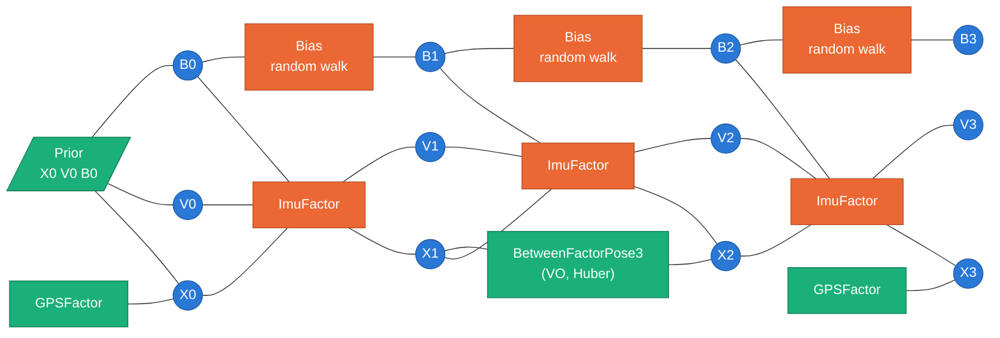
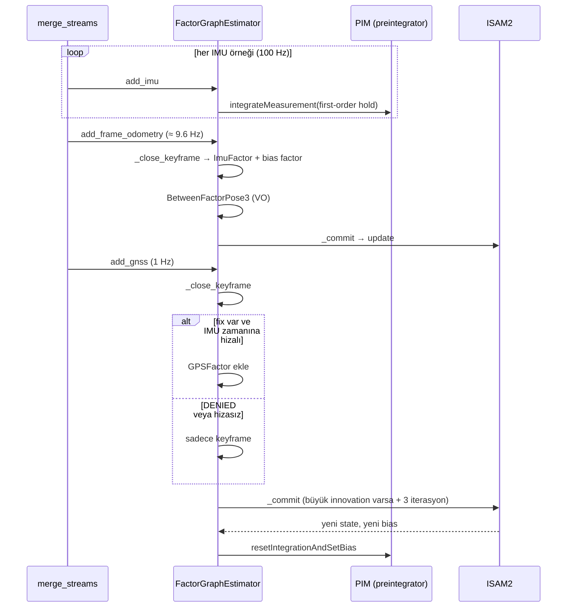

<div align="center">

# 🕸️ Ders 4 · Factor Graph ile Sensör Füzyonu

**Faz 3 (b)** · ⏱️ ~6 saat · 📐 Matematik: ★★★★

[← Ders 3](03_imu_and_dead_reckoning.md) · [İçindekiler](README.md) · [Ders 5 →](05_stereo_visual_odometry.md)

</div>

---

## 🎯 Öğrenme hedefleri

- [ ] State estimation'ı bir **MAP** (Maximum A Posteriori) problemi olarak yazmak
- [ ] MAP'in Gaussian varsayımıyla neden **nonlinear least squares**'e dönüştüğünü türetmek
- [ ] **Gauss-Newton** ve **Levenberg-Marquardt** adımlarını yazmak, manifold üzerinde uygulamak
- [ ] **Factor graph**'ı çizmek ve sparsity'nin neden hız getirdiğini açıklamak
- [ ] **IMU preintegration**'ın hangi problemi çözdüğünü anlamak
- [ ] Projedeki her factor'ün (`ImuFactor`, `GPSFactor`, bias, prior) residual'ını yazmak
- [ ] **ISAM2**'nin incremental çalışmasını, QR vs Cholesky farkını ve **marginal covariance**'ı açıklamak
- [ ] Bu fazda yaşanan dört gerçek hatayı ve derslerini anlatmak

---

## 💡 1. Büyük fikir: herkes oy kullanır

Ders 0'da iki ölçümü ağırlıklı ortalamayla birleştirmiştik. Şimdi elimizde:

- Her 0.01 s'de bir IMU ölçümü (hareket hakkında),
- Her 1 s'de bir GNSS fix'i (konum hakkında, bazen yok),
- Her ≈ 0.1 s'de bir kamera hareketi (Ders 5),
- Başlangıç durumu hakkında bir ön bilgi (**prior**).

Bunların hepsi **bilinmeyen durumlar** (konumlar, hızlar, bias'lar) hakkında kısmi ve gürültülü
bilgi veriyor. Factor graph yaklaşımı der ki:

> Bütün bilinmeyenleri tek bir büyük vektöre koy. Her ölçüm bu vektör için bir **ceza terimi**
> yazsın: "bu değerler benim ölçtüğümle ne kadar uyumsuz?". Bütün cezaların toplamını minimize
> eden vektör, en iyi tahmindir.

---

## 📐 2. MAP → Nonlinear Least Squares

### 2.1 MAP tahmini

Bilinmeyenler $\mathcal{X}$, ölçümler $\mathcal{Z} = \lbrace \mathbf{z}_i \rbrace$. Bayes kuralına göre:

$$
\mathcal{X}^\ast = \arg\max_{\mathcal{X}}\ p(\mathcal{X} \mid \mathcal{Z})
= \arg\max_{\mathcal{X}}\ p(\mathcal{X}) \prod_i p(\mathbf{z}_i \mid \mathcal{X}_i)
$$

Ölçümlerin birbirinden **koşullu bağımsız** olduğunu ve her ölçümün sadece birkaç değişkene
($\mathcal{X}_i$) bağlı olduğunu varsaydık. Bu çarpımın her terimine **factor** denir.

### 2.2 Gaussian gürültü varsayımı

Ölçüm modeli $\mathbf{z}_i = h_i(\mathcal{X}_i) + \boldsymbol{\eta}_i$, $\boldsymbol{\eta}_i \sim \mathcal{N}(\mathbf{0}, \boldsymbol{\Sigma}_i)$ ise:

$$
p(\mathbf{z}_i \mid \mathcal{X}_i) \propto \exp\!\left(-\tfrac{1}{2}\,\lVert h_i(\mathcal{X}_i) - \mathbf{z}_i \rVert^2_{\boldsymbol{\Sigma}_i}\right)
$$

$-\log$ alınca çarpım toplama, maksimizasyon minimizasyona döner:

$$
\boxed{
\mathcal{X}^\ast = \arg\min_{\mathcal{X}}\ \sum_i \big\lVert \underbrace{h_i(\mathcal{X}_i) - \mathbf{z}_i}_{\mathbf{e}_i:\ \text{residual}} \big\rVert^2_{\boldsymbol{\Sigma}_i}
}
$$

### 2.3 Mahalanobis normu

$$
\lVert \mathbf{e} \rVert^2_{\boldsymbol{\Sigma}} = \mathbf{e}^\top \boldsymbol{\Sigma}^{-1} \mathbf{e}
$$

**Sezgi:** Hatayı "kaç sigma" cinsinden ölçer. GNSS'te 1 m'lik hata ($\sigma = 0.5$ m) **2 sigma**,
yani şüpheli. IMU'dan gelen 1 m'lik hata ($\sigma$ = 1 cm) **100 sigma**, yani imkansız.
Covariance böylece "kime ne kadar güveneceğimizi" kodluyor.

Pratikte **whitening** yapılır: $\boldsymbol{\Sigma}^{-1} = \mathbf{L}^\top\mathbf{L}$ (Cholesky)
ise $\lVert\mathbf{e}\rVert^2_{\boldsymbol{\Sigma}} = \lVert \mathbf{L}\mathbf{e} \rVert^2$. Artık
her residual birimsiz ve aynı ölçekte.

💻 **Projede:** `gtsam.noiseModel.Diagonal.Sigmas(...)`, `Gaussian.Covariance(...)`,
`Isotropic.Sigma(...)`. Hepsi bu $\boldsymbol{\Sigma}$'yı tanımlamanın farklı yolları.

---

## 📐 3. Gauss-Newton: doğrusal olmayanı çözmek

$h_i$'ler doğrusal değil (rotasyonlar var). Bu yüzden iteratif çözeriz.

**1. Doğrusallaştır.** Mevcut tahmin $\mathbf{x}_0$ etrafında küçük bir $\boldsymbol{\delta}$ için:

$$
\mathbf{e}(\mathbf{x}_0 \oplus \boldsymbol{\delta}) \approx \mathbf{e}(\mathbf{x}_0) + \mathbf{J}\,\boldsymbol{\delta},
\qquad
\mathbf{J} = \frac{\partial \mathbf{e}}{\partial \boldsymbol{\delta}}
$$

**2. Lineer least squares çöz.** (Whitened) residual'ı minimize et:

$$
\min_{\boldsymbol{\delta}} \lVert \mathbf{J}\boldsymbol{\delta} + \mathbf{e} \rVert^2
\quad\Longrightarrow\quad
\underbrace{(\mathbf{J}^\top\mathbf{J})}_{\boldsymbol{\Lambda}:\ \text{information matrix}}\ \boldsymbol{\delta} = -\mathbf{J}^\top\mathbf{e}
\qquad\text{(normal equations)}
$$

**3. Güncelle ve tekrarla:** $\mathbf{x}_0 \leftarrow \mathbf{x}_0 \oplus \boldsymbol{\delta}$.

Burada $\oplus$, Ders 3'teki **retraction**: vektörler için toplama, rotasyonlar için
$\mathbf{R}\,\text{Exp}(\boldsymbol{\delta})$. Optimizasyon her zaman düz tangent space'te yapılır,
sonuç manifold'a geri sarılır. Rotation'ın 9 sayısıyla değil, 3 sayılık $\boldsymbol{\delta}$ ile
oynarız.

**Levenberg-Marquardt** (LM), adım çok büyükse diye bir sönümleme ekler:
$(\boldsymbol{\Lambda} + \lambda\,\text{diag}(\boldsymbol{\Lambda}))\,\boldsymbol{\delta} = -\mathbf{J}^\top\mathbf{e}$.
$\lambda$ büyükse gradient descent gibi yavaş ve güvenli, küçükse Gauss-Newton gibi hızlı.

> [!TIP]
> **Bonus:** Çözümdeki belirsizlik de bedava gelir. Optimumda covariance yaklaşık olarak
> information matrix'in tersidir: $\boldsymbol{\Sigma}^\ast \approx \boldsymbol{\Lambda}^{-1}$.
> Projedeki `marginalCovariance` bunun ilgili bloğunu döndürür (bölüm 8).

---

## 🕸️ 4. Factor graph

**Factor graph**, MAP probleminin çizimidir: iki tür düğüm var.

- ⭕ **Variable** (değişken): bilinmeyenler.
- ⬛ **Factor**: bir ölçüm / ceza terimi; sadece ilgili olduğu değişkenlere bağlı.

Projedeki graph'ın bir parçası:



| Değişken | GTSAM tipi | Boyut | Anlamı |
|---|---|---|---|
| `X(i)` | `Pose3` | 6 | Keyframe $i$'deki pose (rotation + position, ENU) |
| `V(i)` | `Vector3` | 3 | Keyframe $i$'deki hız (ENU) |
| `B(i)` | `imuBias.ConstantBias` | 6 | Keyframe $i$'deki accel + gyro bias |

Ortada X1 ile X2 arasında GPSFactor yok: blackout'ta GPS factor'ü eklenmez, ama keyframe yine
açılır. Bağlantıyı sadece IMU (ve varsa VO) taşır.

### Neden graph? Sparsity!

Her factor sadece birkaç değişkene dokunduğu için $\mathbf{J}$ ve $\boldsymbol{\Lambda}$
neredeyse tamamen sıfırdır. Zaman sırasıyla dizilmiş bir navigasyon problemi **banded**
(bantlı) bir matris verir. Yoğun bir $n\times n$ sistemi çözmek $O(n^3)$, bantlı bir sistemi
çözmek $O(n)$'dir. Saatlerce sürüşü gerçek zamanda çözebilmemizin nedeni bu.

> [!NOTE]
> **Kalman filter ile ilişkisi.** EKF, bu graph'ın özel bir halidir: her adımda geçmişi
> **marginalize** eder (unutur) ve sadece bir Gauss-Newton iterasyonu yapar. Factor graph ise
> geçmişi tutar ve gerektiğinde yeniden doğrusallaştırır. Blackout sonrası ilk fix geldiğinde,
> graph blackout boyunca olan bütün tahminleri birlikte düzeltebilir (**smoothing**). EKF
> sadece şimdiki durumu düzeltebilir.

---

## 📐 5. IMU preintegration

### Problem

100 Hz IMU'nun her örneği için bir değişken eklersek, saniyede 100 pose demek. Çok büyük. Bunun
yerine sadece **keyframe**'lerde (GNSS epoch'ları, kamera kareleri) değişken tutmak istiyoruz.
Aradaki yüzlerce IMU örneğini tek bir factor'e sıkıştırmalıyız.

Naif yol: Ders 3'teki strapdown denklemlerini $i$'den $j$'ye entegre et. Ama bu entegrasyon
$\mathbf{R}_i, \mathbf{v}_i$'ye bağlı. Optimizer $\mathbf{R}_i$'yi her güncellediğinde, yüzlerce
örneği **yeniden entegre etmek** gerekir. Çok yavaş.

### Çözüm: göreli ölçümler (Forster ve ark., 2017)

Strapdown denklemlerini $i$ anının body frame'ine göre yeniden düzenle. Sadece ölçümlere ve
bias'a bağlı olan **preintegrated** büyüklükleri tanımla:

$$
\boxed{
\begin{aligned}
\Delta\tilde{\mathbf{R}}_{ij} &= \prod_{k=i}^{j-1} \text{Exp}\big((\tilde{\boldsymbol{\omega}}_k - \mathbf{b}_g)\,\Delta t\big) \\
\Delta\tilde{\mathbf{v}}_{ij} &= \sum_{k=i}^{j-1} \Delta\tilde{\mathbf{R}}_{ik}\,(\tilde{\mathbf{a}}_k - \mathbf{b}_a)\,\Delta t \\
\Delta\tilde{\mathbf{p}}_{ij} &= \sum_{k=i}^{j-1} \Big[\Delta\tilde{\mathbf{v}}_{ik}\,\Delta t + \tfrac{1}{2}\Delta\tilde{\mathbf{R}}_{ik}\,(\tilde{\mathbf{a}}_k - \mathbf{b}_a)\,\Delta t^2\Big]
\end{aligned}
}
$$

Bunlarda $\mathbf{R}_i$, $\mathbf{v}_i$, $\mathbf{p}_i$ **yok**. Bir kez hesaplanır, optimizer
ne yaparsa yapsın değişmez. Şimdi bunları durumlarla ilişkilendir:

$$
\begin{aligned}
\Delta\tilde{\mathbf{R}}_{ij} &\approx \mathbf{R}_i^\top\,\mathbf{R}_j \\
\Delta\tilde{\mathbf{v}}_{ij} &\approx \mathbf{R}_i^\top\,(\mathbf{v}_j - \mathbf{v}_i - \mathbf{g}\,\Delta t_{ij}) \\
\Delta\tilde{\mathbf{p}}_{ij} &\approx \mathbf{R}_i^\top\,(\mathbf{p}_j - \mathbf{p}_i - \mathbf{v}_i\,\Delta t_{ij} - \tfrac{1}{2}\mathbf{g}\,\Delta t_{ij}^2)
\end{aligned}
$$

Sağ taraf durumlardan **tahmin edilen**, sol taraf IMU'dan **ölçülen**. Fark = **residual**:

$$
\mathbf{e}_{\text{IMU}} =
\begin{bmatrix}
\text{Log}\big(\Delta\tilde{\mathbf{R}}_{ij}^\top\,\mathbf{R}_i^\top\mathbf{R}_j\big) \\
\mathbf{R}_i^\top(\mathbf{v}_j - \mathbf{v}_i - \mathbf{g}\Delta t_{ij}) - \Delta\tilde{\mathbf{v}}_{ij} \\
\mathbf{R}_i^\top(\mathbf{p}_j - \mathbf{p}_i - \mathbf{v}_i\Delta t_{ij} - \tfrac{1}{2}\mathbf{g}\Delta t_{ij}^2) - \Delta\tilde{\mathbf{p}}_{ij}
\end{bmatrix}
\in \mathbb{R}^9
$$

Rotasyon residual'ında `Log` kullanıldığına dikkat: iki rotasyonun "farkı" bir rotasyondur,
`Log` onu 3 sayılık bir vektöre çevirir.

### Peki bias değişirse?

Preintegrated değerler $\mathbf{b}$'ye bağlı. Optimizer bias'ı biraz güncellerse ($\delta\mathbf{b}$),
yeniden entegre etmek yerine **birinci dereceden düzeltme** yapılır:

$$
\Delta\tilde{\mathbf{R}}_{ij}(\bar{\mathbf{b}} + \delta\mathbf{b}) \approx \Delta\tilde{\mathbf{R}}_{ij}(\bar{\mathbf{b}})\;\text{Exp}\!\left(\frac{\partial\Delta\bar{\mathbf{R}}_{ij}}{\partial\mathbf{b}_g}\,\delta\mathbf{b}_g\right)
$$

(Hız ve konum için benzer lineer düzeltmeler.) Jacobian'lar entegrasyon sırasında birlikte
biriktirilir.

### Preintegration'ın covariance'ı

Her IMU örneğindeki gürültü (Ders 2'deki $\sigma_c/\sqrt{\Delta t}$), preintegrated ölçüme yayılır.
Ders 1'deki $\mathbf{A}\boldsymbol{\Sigma}\mathbf{A}^\top$ kuralı adım adım uygulanır:

$$
\boldsymbol{\Sigma}_{k+1} = \mathbf{A}_k\,\boldsymbol{\Sigma}_k\,\mathbf{A}_k^\top + \mathbf{B}_k\,\boldsymbol{\Sigma}_\eta\,\mathbf{B}_k^\top
$$

Sonuç: iki keyframe ne kadar uzaksa, ImuFactor o kadar "gevşek" olur. Fizik olarak doğru: uzun
süre entegre edilmiş IMU'ya daha az güvenilir.

💻 **Projede:** GTSAM'in `PreintegratedImuMeasurements` sınıfı bütün bunları yapıyor. Proje
sadece parametreleri veriyor
([factor_graph.py:80](../../src/gnss_denied/backend/factor_graph.py#L80)):

```python
pim_params = gtsam.PreintegrationParams.MakeSharedU(params.gravity_mps2)
pim_params.setAccelerometerCovariance(np.eye(3) * accel_density**2)   # σ_c² (sürekli zaman)
pim_params.setGyroscopeCovariance(np.eye(3) * gyro_density**2)
pim_params.setIntegrationCovariance(np.eye(3) * params.integration_sigma**2)
```

GTSAM sürekli zaman density'sini alır ve $\Delta t$ ile ayrıklaştırmayı kendisi yapar.

---

## 📐 6. Projedeki bütün factor'ler

| Factor | Bağlandığı değişkenler | Residual | Noise | Kod |
|---|---|---|---|---|
| `PriorFactorPose3` | X0 | $\text{Log}(\mathbf{T}_0^{-1}\,\mathbf{X}_0)$ | attitude σ, position σ | [L181](../../src/gnss_denied/backend/factor_graph.py#L181) |
| `PriorFactorVector` | V0 | $\mathbf{V}_0 - \mathbf{v}_0$ | velocity σ | [L186](../../src/gnss_denied/backend/factor_graph.py#L186) |
| `PriorFactorConstantBias` | B0 | $\mathbf{B}_0 - \mathbf{0}$ | **datasheet bias σ** | [L193](../../src/gnss_denied/backend/factor_graph.py#L193) |
| `ImuFactor` | Xi, Vi, Xj, Vj, Bi | Yukarıdaki 9 boyutlu $\mathbf{e}_{\text{IMU}}$ | Preintegration covariance | [L312](../../src/gnss_denied/backend/factor_graph.py#L312) |
| `BetweenFactorConstantBias` | Bi, Bj | $\mathbf{B}_j - \mathbf{B}_i$ | $\sigma_{rw}\sqrt{\Delta t_{ij}}$ | [L322](../../src/gnss_denied/backend/factor_graph.py#L322) |
| `GPSFactor` | Xi | $\mathbf{p}_i - \mathbf{z}_{\text{ENU}}$ | Fix covariance (P0 eksenlerine döndürülmüş) | [L348](../../src/gnss_denied/backend/factor_graph.py#L348) |
| `BetweenFactorPose3` | Xi, Xj | $\text{Log}\big(\mathbf{Z}^{-1}\,\mathbf{X}_i^{-1}\mathbf{X}_j\big)$ | VO σ + **Huber** | [L368](../../src/gnss_denied/backend/factor_graph.py#L368) (Ders 5) |

### Bias random walk factor'ü neden $\sqrt{\Delta t}$?

Ders 2'den: bias, density'si $\sigma_{rw}$ olan bir random walk. $\Delta t$ sonra
$\mathbf{b}_j - \mathbf{b}_i \sim \mathcal{N}(\mathbf{0},\ \sigma_{rw}^2\,\Delta t)$. Factor tam olarak
bunu söylüyor: "iki keyframe arasındaki bias farkı sıfıra yakın olmalı, ama ne kadar yakın
olacağı aradaki süreye bağlı".

```python
sqrt_dt = np.sqrt(pim.deltaTij())
bias_sigmas = sqrt_dt * np.r_[accel_bias_random_walk × 3, gyro_bias_random_walk × 3]
```

### Keyframe'ler ne zaman açılıyor?



💻 [factor_graph.py:306](../../src/gnss_denied/backend/factor_graph.py#L306), `_close_keyframe`:
ImuFactor'ü ve bias factor'ü ekler, yeni değişkenler için **başlangıç tahminini** IMU
tahmininden (`pim.predict`) verir. Gauss-Newton'un iyi bir başlangıç noktasına ihtiyacı var;
IMU tahmini mükemmel bir başlangıç noktası.

---

## 📐 7. ISAM2: incremental çözüm

Her yeni ölçümde bütün graph'ı sıfırdan çözmek pahalı. **ISAM2** (Kaess ve ark., 2012) şunu yapar:

1. Graph'ı **variable elimination** ile bir **Bayes tree**'ye çevirir (bu, $\boldsymbol{\Lambda}$'nın
   sparse faktorizasyonunun ağaç şeklindeki hali).
2. Yeni factor geldiğinde, ağacın **sadece etkilenen kısmını** yeniden hesaplar. Navigasyonda bu
   genelde sadece son birkaç keyframe.
3. **Fluid relinearization**: sadece tahmini belirgin şekilde değişen değişkenleri yeniden
   doğrusallaştırır (projede eşik 0.01).

```python
isam_params.setRelinearizeThreshold(0.01)
isam_params.relinearizeSkip = 1
isam_params.setFactorization("QR")
```

💻 [factor_graph.py:152](../../src/gnss_denied/backend/factor_graph.py#L152)

### 🐞 Gerçek hata #1: Cholesky "IndeterminantLinearSystem"

**Belirti:** IMU'daki 1.62 s'lik deliği köprüleyen gevşek bir factor eklenince GTSAM
`IndeterminantLinearSystemException` fırlattı.

**Neden:** Normal equations $\boldsymbol{\Lambda} = \mathbf{J}^\top\mathbf{J}$ formundadır. Bir
matrisin **condition number**'ı $\kappa$ ise:

$$
\kappa(\mathbf{J}^\top\mathbf{J}) = \kappa(\mathbf{J})^2
$$

Normal IMU factor'leri çok sıkı (integration σ ≈ $10^{-4}$), boşluk factor'ü çok gevşek
(σ ≈ 1). Whitening, her satırı kendi sigma'sına böler; böylece aynı Jacobian'da $10^4$ ile ölçeklenmiş
satırlarla ≈ 1 ile ölçeklenmiş satırlar yan yana durur. Bu ölçek farkları sıkı prior'lar ve
zincirleme keyframe'lerle birleşince $\kappa(\mathbf{J})$ büyür, kare alındığında `double`'ın
göreli hassasiyetine ($\approx 2.2\times10^{-16}$) yaklaşır. **Cholesky** $\boldsymbol{\Lambda}$
üzerinde çalışır ve karesi alınmış condition number'ı görür.

**Çözüm:** **QR** faktorizasyonu $\mathbf{J}$'nin kendisi üzerinde çalışır, kareyi almaz. Biraz
daha yavaş ama sayısal olarak çok daha sağlam.

> [!TIP]
> **Genel ders:** Bir sistemde çok sıkı ve çok gevşek kısıtları yan yana koyuyorsan, sayısal
> kararlılık bir tasarım konusu haline gelir. "Matematik doğru ama bilgisayar yanlış" hatalarının
> en klasik örneği budur.

### IMU deliği nasıl köprüleniyor?

Sürüş 0018'de t ≈ 156.6 s'de 1.62 s boyunca IMU verisi yok. White noise modeli ("her örnekte
biraz titreşim") bu delik hakkında hiçbir şey söylemez: o sürede araç fren de yapmış olabilir.
Proje bu aralığı kendi keyframe çifti ve **şişirilmiş** bir gürültüyle köprüler:

$$
\sigma_{\text{density}} = \sigma_{\text{gap}}\,\sqrt{\Delta t}
\quad\Rightarrow\quad
\text{velocity σ} \approx \sigma_{\text{gap}}\,\Delta t
$$

$\sigma_{\text{gap}} = 1$ m/s², $\Delta t = 1.62$ s → hızda ≈ 1.6 m/s belirsizlik. "Bu sürede
1 m/s² kadar bilinmeyen bir ivme olmuş olabilir" demek.

💻 [factor_graph.py:287](../../src/gnss_denied/backend/factor_graph.py#L287), `_bridge_gap`.

---

## 📐 8. Marginal covariance ve bir frame tuzağı

Kullanıcıya sadece konumu değil, belirsizliğini de vermek istiyoruz (Rerun'daki 3σ elipsoidi).

```python
pose_covariance = self._isam.marginalCovariance(X(self._key))   # 6×6
rotation = self._state.attitude().matrix()
position_covariance = rotation @ pose_covariance[3:, 3:] @ rotation.T
```

💻 [factor_graph.py:254](../../src/gnss_denied/backend/factor_graph.py#L254)

İki ince nokta:

1. **`[3:, 3:]`**: Pose3 tangent space'i önce rotation, sonra translation. Konum bloğu sağ alt köşe.
2. **`rotation @ ... @ rotation.T`**: GTSAM'de Pose3'ün retraction'ı $\mathbf{T}\,\text{Exp}(\boldsymbol{\delta})$
   şeklinde, yani perturbation **body frame**'de. Konum covariance'ı body eksenlerinde çıkıyor;
   ENU'da göstermek için Ders 1'deki $\mathbf{R}\boldsymbol{\Sigma}\mathbf{R}^\top$ ile döndürülüyor.

---

## 🐞 9. Bu fazda yaşanan diğer gerçek hatalar

### Hata #2: Füzyon, sadece IMU'dan kötüydü (213 m)

**Belirti:** IMU + GNSS füzyonunun blackout sonundaki hatası 213 m, saf dead reckoning'den bile kötü.

**Yanlış hipotez:** Tilt ile bias arasındaki bir **coupling** sanıldı.

**Gerçek neden:** Gyro bias prior'ı çok gevşekti. Graph, GNSS'in normal gürültüsünü
"açıklamak" için sensörde olmayan bir **z-gyro bias'ı** (≈ −0.003 rad/s) uydurdu. Blackout
başlayınca bu sahte bias 60 s boyunca entegre edildi: ≈ 5° heading hatası.

**Ders: prior bir regularization'dır.** Gözlemlenebilirliği zayıf bir değişkene (yalnız konum
ölçen GNSS ile z-gyro bias'ı zayıf gözlemlenir) gevşek prior verirsen, optimizer gürültüyü o
değişkene **overfit** eder. Çözüm: prior'ları datasheet'ten al.

```python
# Keep the bias priors close to the sensor's datasheet. With a loose gyro prior, the graph
# explains GNSS noise with a bias the sensor does not have, and then drifts in a blackout.
gyro_bias_sigma_radps: float = 5e-4
```

💻 [factor_graph.py:68](../../src/gnss_denied/backend/factor_graph.py#L68)

### Hata #3: Fix yanlış keyframe'e bağlanıyordu

**Belirti:** IMU deliği sırasında 2.26 m hata, ama graph kendinden emin (σ = 0.16 m).

**Neden:** Keyframe son IMU örneğinin zamanında açılıyor. IMU sustuğunda, GNSS fix'i keyframe'den
farklı bir ana ait. Aracın hızı $v$ ve zaman farkı $\Delta t$ ise, hata $v\,\Delta t$ kadar:
araç hareket ederken fix'i yanlış zamana bağlamak, hareketi konum hatasına çevirir.

**Çözüm:** Zaman farkı 20 ms'den büyükse fix'i reddet ve say (`rejected_unaligned_fixes`).

```python
offset_s = abs(measurement.timestamp - self._integrated_until)
if offset_s <= self._params.max_fix_offset_s:
    ...
else:
    self.rejected_unaligned_fixes += 1
```

💻 [factor_graph.py:243](../../src/gnss_denied/backend/factor_graph.py#L243)

> [!IMPORTANT]
> "Kendinden emin ama yanlış" (σ = 0.16, hata = 2.26 m, yani 14σ) bir estimator'ın en tehlikeli
> halidir. Ders 6'daki **NEES** testi tam olarak bu durumu yakalamak için var.

### Hata #4: Blackout sonrası ilk fix'te toparlanamama (15.7 m)

**Belirti:** 60 s'lik blackout sonrası ilk fix geldi, ama hata 15.7 m'de kaldı.

**Neden:** ISAM2 her `update`'te **tek bir** Gauss-Newton adımı atar. Normalde yeterli, çünkü her
yeni ölçüm küçük bir düzeltme getirir. Ama blackout sonrası düzeltme onlarca metre; doğrusallaştırma
bu kadar büyük bir adımda yetersiz kalır.

**Çözüm:** **Innovation** (fix ile tahmin arasındaki fark) 5 m'yi aşarsa 3 ekstra iterasyon.

```python
if innovation_m > self._params.large_innovation_m:
    extra_iterations = self._params.large_innovation_iterations
```

---

## 💡 10. Online estimate vs smoothed trajectory

| | `current_state()` | `smoothed_trajectory()` |
|---|---|---|
| Ne? | O anda, o ana kadarki veriyle en iyi tahmin | Bütün keyframe'ler, **sonradan** gelen veriyle de düzeltilmiş |
| Gerçek zamanlı mı? | Evet | Hayır |
| Blackout'ta | Drift eder | Blackout sonrası fix'ler geçmişi de düzeltir, çok daha iyi görünür |
| Ne için kullanılır? | Araç kontrolü, **bu projenin metrikleri** | Harita oluşturma, post-processing |

> [!WARNING]
> Smoothed trajectory ile online drift'i ölçmek **hile** olur: blackout boyunca aslında
> bilmediğin bilgiyi kullanmış olursun. Projedeki bütün metrikler `FusionStep.fused`'dan, yani
> online tahminden hesaplanıyor.

---

## 🧪 Alıştırmalar

**1.** Tek değişkenli bir problem: $x$ hakkında iki ölçüm $z_1 = 10$ ($\sigma=1$), $z_2 = 12$
($\sigma=2$). Least squares maliyetini yaz, türevini sıfıra eşitle. Ders 0'daki sonucu buluyor musun?

<details>
<summary>Çözüm</summary>

$C(x) = (x-10)^2/1 + (x-12)^2/4$. $C'(x) = 2(x-10) + (x-12)/2 = 0$ → $2.5x = 26$ → $x = 10.4$ ✅.
Information: $C''(x)/2 = 1 + 1/4 = 1.25$ → $\sigma^2 = 0.8$ ✅. Factor graph, Ders 0'daki
ağırlıklı ortalamanın genellemesi.

</details>

**2.** 1 s arayla iki keyframe var, gyro bias random walk $3\times10^{-5}$ rad/s²/√Hz (`mems`
estimator). `BetweenFactorConstantBias`'ın gyro sigma'sı nedir? 60 s'lik blackout boyunca bias
toplamda ne kadar gezinebilir (1σ)?

<details>
<summary>Çözüm</summary>

1 s için $3\times10^{-5}\sqrt{1} = 3\times10^{-5}$ rad/s. 60 s için $3\times10^{-5}\sqrt{60} = 2.3\times10^{-4}$ rad/s.
Bu, başlangıç bias belirsizliğinin ($5\times10^{-4}$) yarısı kadar; yani blackout'ta bias'ın
kendisi de anlamlı ölçüde değişebilir.

</details>

**3.** Bir Jacobian'ın tekil değerleri $10^4$ ve $10^{-4}$. $\kappa(\mathbf{J})$ ve $\kappa(\mathbf{J}^\top\mathbf{J})$
nedir? `double` hassasiyetiyle Cholesky güvenli mi?

<details>
<summary>Çözüm</summary>

$\kappa(\mathbf{J}) = 10^8$, $\kappa(\mathbf{J}^\top\mathbf{J}) = 10^{16}$. `double`'ın göreli
hassasiyeti $\approx 2.2\times10^{-16}$, yani $1/\kappa$ ile aynı mertebede: Cholesky sayısal olarak
tekil bir matris görür. QR $10^8$ ile çalışır, güvenli.

</details>

**4. (Kod)** `configs/default_sim.yaml`'da `mems.initial_sigmas.gyro_bias_sigma_radps`'ı
`5.0e-4`'ten `1.0e-2`'ye çıkar ve çalıştır:

```bash
uv run --extra all python scripts/run_pipeline.py --imu-profile mems --vo none --no-rerun
```

Blackout sonu hatası ve tahmin edilen gyro bias nasıl değişiyor? Hata #2'yi kendin üret.

**5. (Düşünce)** GNSS sadece konum ölçüyor. Araç düz bir yolda sabit hızla giderken yaw
gözlemlenebilir mi? Virajda?

<details>
<summary>Çözüm</summary>

**Düz ve sabit hızda: hayır.** Accelerometer sadece yerçekimini görür; aracı z ekseni etrafında
döndürsen bile bu ölçüm değişmez. GNSS de ENU hızını kısıtlar ama aracın burnunun nereye baktığını
söylemez. Yani yaw'ı değiştiren her çözüm, bütün ölçümleri aynı derecede iyi açıklar.

**Virajda veya ivmelenirken: evet.** Artık body'de ölçülen ivmenin ENU'ya hangi açıyla döndürüldüğü
önemli: yanlış yaw, GNSS konumlarıyla uyuşmayan bir yörünge üretir. Böylece yaw, ve onun
türeviyle bağlı z-gyro bias'ı, gözlemlenebilir olur. Projedeki
`test_constant_bias_is_recovered_from_a_turning_trajectory` testinin yörüngesinin **dönen** bir
yörünge olmasının nedeni bu ([test_factor_graph.py:145](../../tests/test_factor_graph.py#L145)).
Manevra **observability**'yi artırır; uzun
düz yollar, Hata #2'deki gibi zayıf gözlemlenen değişkenlerin gevşek prior'la kaymasına
uygun zemindir.

</details>

---

## ✅ Kendini kontrol et

- MAP neden Gaussian varsayımıyla least squares'e dönüşür? `-log` adımını yazabilir misin?
- $\boldsymbol{\Lambda} = \mathbf{J}^\top\mathbf{J}$ neden sparse ve neden bu önemli?
- Preintegration olmasaydı optimizer'ın her adımda ne yapması gerekirdi?
- Bias factor'ünün sigma'sı neden $\sqrt{\Delta t}$ ile büyüyor?
- QR neden Cholesky'den daha kararlı?
- Gevşek bir prior neden bir **overfitting** kaynağı olabilir?
- Projede metrikler neden smoothed trajectory'den değil, online tahminden hesaplanıyor?

<div align="center">

[← Ders 3](03_imu_and_dead_reckoning.md) · [İçindekiler](README.md) · **[Ders 5 · Stereo visual odometry →](05_stereo_visual_odometry.md)**

</div>
