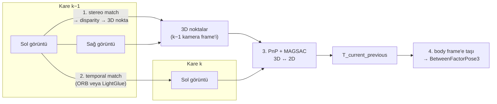

<div align="center">

# 📷 Ders 5 · Stereo Visual Odometry

**Faz 4** · ⏱️ ~5 saat · 📐 Matematik: ★★★☆

[← Ders 4](04_factor_graphs_and_gtsam.md) · [İçindekiler](README.md) · [Ders 6 →](06_evaluation_and_showcase.md)

</div>

---

## 🎯 Öğrenme hedefleri

- [ ] **Pinhole camera model**'i ve **intrinsics** matrisi $\mathbf{K}$'yı yazmak
- [ ] Rectified stereo'da **disparity**'den derinlik hesaplamak ve derinlik hatasının neden $Z^2$ ile büyüdüğünü göstermek
- [ ] Klasik (**ORB**) ve öğrenilmiş (**ALIKED + LightGlue**) feature matching'i karşılaştırmak
- [ ] **PnP** problemini, **RANSAC**'ın iterasyon sayısını ve **MAGSAC** fikrini açıklamak
- [ ] Kamera frame'indeki hareketi body frame'e taşımak (**conjugation**)
- [ ] VO kısıtını **Huber** robust kernel ile graph'a eklemek
- [ ] Neden **monocular** VO'nun bu proje için yetmediğini açıklamak

---

## 💡 1. Kamera neden bu kadar iyi bir relative sensör?

IMU, hareketi **ivmeden** çıkarır: iki kez entegre etmek gerekir, hatalar $t^2$–$t^3$ ile büyür
(Ders 3). Kamera ise hareketi **doğrudan geometriden** ölçer: aynı noktaları iki karede görürsün
ve aradaki dönme ve ötelemeyi hesaplarsın. Entegrasyon zinciri bir kademe kısa; hata, kare başına
bağımsız küçük hatalar toplandığı için kabaca **mesafeyle doğrusal** büyür.



💻 **Projede:** [visual_odom.py:131](../../src/gnss_denied/frontend/visual_odom.py#L131),
`StereoVisualOdometry`. Bütün akış `process → _triangulate → _estimate` üç fonksiyonda.

---

## 📐 2. Pinhole camera model

Kamera frame'inde (x sağ, y aşağı, z ileri) bir 3D nokta $\mathbf{P} = (X, Y, Z)$, görüntüde
şu piksele düşer:

$$
\boxed{
u = f_x\,\frac{X}{Z} + c_x,
\qquad
v = f_y\,\frac{Y}{Z} + c_y
}
\qquad\Longleftrightarrow\qquad
Z\begin{bmatrix} u \\ v \\ 1 \end{bmatrix} =
\underbrace{\begin{bmatrix} f_x & 0 & c_x \\ 0 & f_y & c_y \\ 0 & 0 & 1 \end{bmatrix}}_{\mathbf{K}}
\begin{bmatrix} X \\ Y \\ Z \end{bmatrix}
$$

| Sembol | Anlamı | KITTI (sürüş 0018) |
|---|---|---|
| $f_x, f_y$ | Piksel cinsinden **focal length** | ≈ 707 px |
| $c_x, c_y$ | **Principal point** (optik eksenin görüntüyü kestiği nokta) | ≈ görüntü merkezi |

Bölme $X/Z$ derinlik bilgisini yok eder: yakındaki küçük bir nesne ile uzaktaki büyük bir nesne
aynı pikselleri kaplar. **Tek kameranın temel problemi bu.**

**Ters yön (back-projection):** pikseli ve derinliği biliyorsan 3D noktayı geri alırsın:

$$
X = \frac{(u - c_x)\,Z}{f_x},
\qquad
Y = \frac{(v - c_y)\,Z}{f_y}
$$

💻 [visual_odom.py:168](../../src/gnss_denied/frontend/visual_odom.py#L168), birebir bu formül.

---

## 📐 3. Stereo: derinliği geri kazanmak

### Rectification

İki kamera yan yana, aralarında **baseline** $b$ var. **Rectification**, iki görüntüyü sanki
kameralar tamamen paralelmiş gibi yeniden örnekler. Sonuç: bir nokta iki görüntüde **aynı satırda**
görünür. Eşleşme aramak 2D'den 1D'ye iner. (KITTI `sync` setindeki görüntüler zaten rectified.)

### Disparity → depth

Aynı nokta sol görüntüde $u_L$'de, sağda $u_R$'de. **Disparity** $d = u_L - u_R$. Benzer
üçgenlerden:

$$
\boxed{Z = \frac{f\,b}{d}}
$$

KITTI'de $f \approx 707$ px, $b \approx 0.537$ m, yani $f\,b \approx 380$ px·m.

### Derinlik hatası neden $Z^2$ ile büyür?

$Z = fb/d$'nin $d$'ye göre türevini alıp Ders 1'deki hata yayılımını uygula:

$$
\frac{\partial Z}{\partial d} = -\frac{fb}{d^2} = -\frac{Z^2}{fb}
\qquad\Rightarrow\qquad
\boxed{\sigma_Z = \frac{Z^2}{f\,b}\,\sigma_d}
$$

| Derinlik $Z$ | Disparity $d$ | $\sigma_Z$ ($\sigma_d$ = 0.5 px) |
|---|---|---|
| 5 m | 76 px | 3 cm |
| 20 m | 19 px | 53 cm |
| 50 m | 7.6 px | 3.3 m |
| 127 m | **3 px** (projedeki alt sınır) | 21 m |

**Sonuç:** yakın noktalar çok değerli, uzak noktalar neredeyse sadece **yön** bilgisi taşır.

### Projedeki iki filtre

```python
on_epipolar = np.abs(left_px[:, 1] - right_px[:, 1]) <= max_epipolar_error_px   # 1.5 px
valid = on_epipolar & (disparity >= min_disparity_px)                           # 3 px
```

💻 [visual_odom.py:153](../../src/gnss_denied/frontend/visual_odom.py#L153)

1. **Epipolar kontrol:** rectified görüntüde eşleşmeler aynı satırda olmalı. 1.5 px'ten fazla
   satır farkı = yanlış eşleşme.
2. **Minimum disparity:** 3 px'ten küçük disparity = 127 m'den uzak, derinliği güvenilmez.

---

## 📐 4. Feature detection ve matching

İki görüntüde "aynı noktayı" bulmak için önce belirgin noktalar (**keypoints**) seçilir, her biri
için bir parmak izi (**descriptor**) hesaplanır, sonra parmak izleri karşılaştırılır.

### 4.1 Klasik: ORB

**ORB** = Oriented FAST + Rotated BRIEF.

| Adım | Ne yapar? |
|---|---|
| **FAST** | Bir pikselin etrafındaki 16 piksellik çemberde, yeterince uzun bir parlak/karanlık yay varsa köşe der. Çok hızlı. |
| **Orientation** | Yamadaki parlaklık ağırlık merkezinin yönünü hesaplar, böylece descriptor dönmeye dayanıklı olur. |
| **rBRIEF** | Yamadaki 256 piksel çiftini karşılaştırır: "A, B'den parlak mı?" → 256 bit = 32 byte. |
| **Hamming distance** | İki descriptor'ı XOR + bit sayımıyla karşılaştırır. Bir CPU komutu. |

**Projedeki eşleştirme kuralları** ([visual_odom.py:91](../../src/gnss_denied/frontend/visual_odom.py#L91)):

- **Lowe ratio test:** En iyi eşleşmenin mesafesi ikinci en iyinin %80'inden küçük olmalı:
  $d_1 < 0.8\,d_2$. Belirsiz eşleşmeleri (tekrarlayan desenler, pencereler) eler.
- **Mutual check:** A'nın en iyisi B ise, B'nin en iyisi de A olmalı.

### 4.2 Öğrenilmiş: ALIKED + LightGlue

| | ORB | ALIKED + LightGlue |
|---|---|---|
| Keypoint | El yapımı kural (FAST) | CNN'in öğrendiği skor haritası |
| Descriptor | 256 bit, piksel karşılaştırma | 128 boyutlu float vektör, **deformable** örnekleme |
| Matching | Her nokta tek başına, en yakın komşu | **Transformer**: noktalar birbirine "bakarak" eşleşir |
| Bağlam | Yok | Var: komşu eşleşmeler birbirini destekler |
| Hız (Apple M5) | 18 kare/s | 2.4 kare/s |

**ALIKED**, her keypoint'in etrafında sabit bir ızgara yerine, ağın öğrendiği **deformable**
konumlardan örnekleme yapar; perspektif değişimine daha dayanıklıdır.

**LightGlue** bir transformer'dır. Kalbi **attention**:

$$
\text{Attention}(\mathbf{Q}, \mathbf{K}, \mathbf{V}) = \text{softmax}\!\left(\frac{\mathbf{Q}\mathbf{K}^\top}{\sqrt{d}}\right)\mathbf{V}
$$

- **Self-attention**: bir görüntüdeki noktalar birbirine bakar ("ben bir pencerenin köşesiyim,
  yanımda başka pencereler var").
- **Cross-attention**: bir görüntüdeki noktalar diğer görüntüdekilere bakar ("karşı tarafta bana
  benzeyen kim?").
- Birkaç katmandan sonra her nokta için bir eşleşme olasılığı ve bir **matchability** skoru
  ("benim karşılığım hiç görünmüyor olabilir") çıkar. "Adaptive": kolay görüntü çiftlerinde
  erken durur.

💻 [deep_features.py:25](../../src/gnss_denied/frontend/deep_features.py#L25), `AlikedLightGlueBackend`.

> [!NOTE]
> Orijinal plan **SuperPoint + LightGlue**'ydu. Ama `kornia`, LightGlue'nun SuperPoint ağırlıklarını
> içeriyor, SuperPoint ağının kendisini içermiyor (ve o ağırlıklar ticari olmayan kullanım için).
> ALIKED uçtan uca mevcut olduğu için onunla değiştirildi. Bu tür "planla gerçek arasındaki fark"
> notlarını kodda bırakmak iyi bir alışkanlık.

### 💡 Tasarım: `FeatureBackend` protocol'ü

```python
class FeatureBackend(Protocol):
    name: str
    def extract(self, image: np.ndarray) -> Features: ...
    def match(self, first: Features, second: Features) -> NDArray[np.int64]: ...
```

VO geri kalanı sadece bu arayüzü bilir. ORB ve ALIKED birbirinin yerine takılabilir; benchmark'ın
"klasik vs öğrenilmiş" karşılaştırması tek satırla mümkün. (**Strategy pattern**.)

---

## 📐 5. PnP: 3D ↔ 2D'den hareket

### Problem

Elimizde $k-1$ karesinin kamera frame'inde 3D noktalar $\mathbf{P}_i$ (stereo'dan) ve bunların
$k$ karesindeki pikselleri $\mathbf{u}_i$ (temporal matching'den) var. Bul:
$\mathbf{T} = \mathbf{T}_{c_k\,c_{k-1}}$, öyle ki

$$
\boxed{
\mathbf{T}^\ast = \arg\min_{\mathbf{T}\in SE(3)} \sum_i \big\lVert \mathbf{u}_i - \pi\big(\mathbf{K},\ \mathbf{T}\,\mathbf{P}_i\big) \big\rVert^2
}
$$

Bu **reprojection error**'dır: noktayı yeni kameraya taşı, görüntüye düşür, ölçülen pikselle
karşılaştır. Problem **Perspective-n-Point** (**PnP**) adını taşır.

**Stereo'nun kritik katkısı:** $\mathbf{P}_i$ metre cinsinden olduğu için çözülen $\mathbf{T}$'nin
ötelemesi de **metre** cinsindendir.

### Neden monocular yetmez?

Tek kamerada iki kare arasındaki ilişki **essential matrix** ile kurulur:

$$
\mathbf{x}_2^\top\,\mathbf{E}\,\mathbf{x}_1 = 0,
\qquad
\mathbf{E} = [\mathbf{t}]_\times\,\mathbf{R}
$$

$\mathbf{t}$ yerine $\lambda\mathbf{t}$ koyarsan denklem hâlâ sağlanır. Yani **ölçek bilinemez**:
sadece hareketin yönü bulunur. Graph'ın drift'i sınırlamak için **metreye** ihtiyacı var; bu yüzden
`_add_visual_odometry_factor`, `scale_known=False` olan bir kısıtı reddeder
([factor_graph.py:352](../../src/gnss_denied/backend/factor_graph.py#L352)).

### RANSAC: outlier'lara karşı

Eşleşmelerin bir kısmı yanlıştır (**outlier**). Least squares tek bir outlier'la bile bozulur.
**RANSAC** (RANdom SAmple Consensus):

1. Rastgele minimal bir alt küme seç (PnP için 3–4 nokta).
2. Bu alt kümeden bir $\mathbf{T}$ hesapla.
3. Kaç noktanın bu $\mathbf{T}$ ile uyumlu olduğunu say (reprojection error < 1.5 px → **inlier**).
4. En çok inlier'ı vereni tut. Tekrarla.

**Kaç iterasyon gerekir?** Inlier oranı $w$, örnek boyutu $s$, istenen başarı olasılığı $p$ ise:

$$
\boxed{N = \frac{\log(1 - p)}{\log(1 - w^s)}}
$$

**Türetme:** Bir örneğin tamamen inlier olması olasılığı $w^s$. $N$ denemenin hepsinin başarısız
olma olasılığı $(1 - w^s)^N$. Bunu $1-p$'ye eşitle.

| Inlier oranı $w$ | $s = 4$, $p = 0.999$ için $N$ |
|---|---|
| %70 | ≈ 26 |
| %50 | ≈ 108 |
| %30 | ≈ 850 |

Projede `ransac_iterations = 500`, `confidence = 0.999`.

**MAGSAC**, sabit bir eşik (1.5 px) yerine, gürültü ölçeği $\sigma$ üzerinden **marginalize** eder:
her nokta kesin "inlier/outlier" yerine, olasılığıyla ağırlıklandırılır. Eşik seçimine daha az
hassastır. Projede `flags=cv2.USAC_MAGSAC`.

**Son rötuş:** RANSAC'ın bulduğu çözüm inlier'lar üzerinde **Levenberg-Marquardt** ile
(`solvePnPRefineLM`) iyileştirilir. Ders 4'teki LM'nin aynısı, sadece daha küçük bir problem.

💻 [visual_odom.py:177](../../src/gnss_denied/frontend/visual_odom.py#L177), `_estimate`.

---

## 📐 6. Kamera hareketinden body hareketine

PnP $\mathbf{T}_{c_k\,c_{k-1}}$ verir: önceki kamera frame'indeki bir noktayı şimdikine taşır.
Graph ise **body** (IMU) frame'inde, önceki pose'tan şimdikine **hareket** ister:
$\mathbf{T}_{b_{k-1}\,b_k}$. İndis kuralıyla (Ders 0):

$$
\mathbf{T}_{b_{k-1}\,b_k}
= \mathbf{T}_{b\,c}\;\underbrace{\mathbf{T}_{c_{k-1}\,c_k}}_{(\mathbf{T}_{c_k\,c_{k-1}})^{-1}}\;\mathbf{T}_{c\,b}
$$

Kamera araca sabit olduğu için $\mathbf{T}_{b\,c}$ her karede aynı. Bu işleme **conjugation**
(benzerlik dönüşümü, baz değiştirme) denir.

```python
T_previous_current = np.linalg.inv(T_current_previous)
motion_body = T_body @ T_previous_current @ np.linalg.inv(T_body)
```

💻 [visual_odom.py:210](../../src/gnss_denied/frontend/visual_odom.py#L210). $\mathbf{T}_{b\,c}$,
KITTI kalibrasyon dosyalarından zincirle hesaplanır (Ders 0'daki
`T_rectified_imu = T_rectified_camera @ T_camera_velo @ T_velo_imu` satırı).

> [!WARNING]
> Bu satırdaki en küçük hata (`inv`'i unutmak, çarpım sırasını ters yazmak) VO'yu tamamen
> bozar ama **çökmez**: sadece hareket yanlış yöne gider. Bu yüzden
> [tests/test_visual_odom.py](../../tests/test_visual_odom.py) sentetik bir sahnede bilinen bir
> hareketin geri bulunduğunu test ediyor.

---

## 📐 7. VO'yu graph'a eklemek: noise ve Huber

### Noise model

Her VO kısıtı, `BetweenFactorPose3` olarak iki kamera keyframe'i arasına eklenir. Covariance
çapraz: rotation için $\sigma_R$ = 1e-3 rad, translation için $\sigma_t$ = 0.05 m
(`configs/default_sim.yaml`).

Ground truth'a karşı ölçülen gerçek kare başı hata daha küçük (≈ 5e-4 rad, ileri yönde 0.03 m).
Neden daha büyük sigma? Çünkü **ardışık karelerin hataları korelasyonlu** (aynı yol, aynı ışık,
aynı binalar). White noise modeli bunu ifade edemez; sigma'yı şişirmek, graph'ın VO'ya aşırı
güvenmesini engellemenin basit bir yolu.

### 🔢 Bias ve variance: sistematik hata neden daha tehlikeli?

60 s blackout ≈ 576 kare ($60 \times 9.6$), toplam ≈ 410 m.

| Hata tipi | Kare başı | 576 kare sonra | Büyüme |
|---|---|---|---|
| Rastgele (bağımsız) | 0.03 m | $0.03\sqrt{576} = 0.72$ m | $\sqrt{N}$ |
| Sistematik (%1 ölçek hatası) | 0.007 m | $0.01 \times 410 = 4.1$ m | $N$ |

Rastgele hatalar birbirini kısmen götürür, sistematik hatalar toplanır. Projede ALIKED'in kare
başı gürültüsü ORB'den çok daha düşük, ama tek başına VO olarak 60 s'de **12.1 m** sapıyor (ORB
**8.3 m**). İleri yöndeki hareketinde ≈ %1'lik sabit bir hata var; nedeni araştırılmadı. Ders:
**kare başı hata metriği, uzun vadeli drift'i öngörmek için yetmez.**

### Huber robust kernel

Bazı kareler kötüdür (hareketli bir kamyon, motion blur). Gaussian varsayımı altında, residual'ı
10σ olan bir kare maliyete $10^2 = 100$ katkı yapar ve graph'ı çeker. **Huber** loss, belli bir
eşikten sonra karesel değil **doğrusal** büyür:

$$
\rho_k(r) =
\begin{cases}
\tfrac{1}{2}\,r^2 & \lvert r \rvert \le k \\[4pt]
k\,\lvert r \rvert - \tfrac{1}{2}\,k^2 & \lvert r \rvert > k
\end{cases}
$$

Burada $r$, whitened residual'ın normu (Mahalanobis mesafesi). Pratikte bu, ölçümü
**ağırlıklandırmaya** denktir (**IRLS**, Iteratively Reweighted Least Squares):

$$
w(r) =
\begin{cases}
1 & \lvert r \rvert \le k \\
k / \lvert r \rvert & \lvert r \rvert > k
\end{cases}
$$

| Residual | Gaussian ağırlık | Huber ağırlık ($k$ = 1.345) |
|---|---|---|
| 1σ | 1 | 1 |
| 3σ | 1 | 0.45 |
| 10σ | 1 | 0.13 |

**Neden $k = 1.345$?** Veri gerçekten Gaussian ise, Huber estimator'ı en iyi (least squares)
estimator'ın verimliliğinin **%95**'ini korur. Yani outlier yokken neredeyse hiçbir şey
kaybetmezsin, varken çok şey kazanırsın.

```python
noise = gtsam.noiseModel.Robust.Create(
    gtsam.noiseModel.mEstimator.Huber.Create(_VO_HUBER_THRESHOLD),   # 1.345
    gtsam.noiseModel.Gaussian.Covariance(constraint.covariance_6x6),
)
```

💻 [factor_graph.py:351](../../src/gnss_denied/backend/factor_graph.py#L351)

> [!TIP]
> Daha agresif kernel'lar da var: **Cauchy** ($w = 1/(1 + r^2/k^2)$) ve **Tukey** (eşik ötesinde
> $w = 0$, ölçümü tamamen yok sayar). Ama bunlar **non-convex**'tir, kötü bir başlangıç noktasında
> yanlış çözüme kilitlenebilir. Huber convex olduğu için güvenli bir varsayılan. GNSS spoofing
> savunması (bir sonraki adım) için bu seçim tekrar önemli olacak.

---

## 📊 8. Sonuç: Faz 4 gate'i

| IMU | Mod | Blackout sonu hata (m), 8 seed medyan [min, max] |
|---|---|---|
| `mems` | GNSS + IMU | 103.55 [38.71, 197.84] |
| `mems` | + Classic ORB | 4.79 [4.44, 5.88] |
| `mems` | + **ALIKED + LightGlue** | **2.23** [1.44, 3.89] |

$$
\text{azalma} = 1 - \frac{2.23}{103.55} = 97.8\% \quad > \quad 80\%\ \text{gate} \ ✅
$$

Seed aralığının da daraldığına dikkat et: IMU'nun şansına bağlılık azaldı, sistem daha
**öngörülebilir** hale geldi.

### 💡 Pratik bir tasarım: odometry cache

ALIKED bütün sürüşü 19 dakikada işliyor. Her noise ayarında yeniden çalıştırmamak için VO
sonuçları `data/cache/vo_<drive>_<backend>.npz`'ye kaydedilir. **Noise kaydedilmez**, sadece
ölçülen hareket ([visual_odom.py:247](../../src/gnss_denied/frontend/visual_odom.py#L247)). Böylece
sigma'ları YAML'dan değiştirip saniyeler içinde tekrar füzyon yapabilirsin. Ölçümü ve modelini
ayırmak deney hızını büyük ölçüde artırır.

---

## 🧪 Alıştırmalar

**1.** KITTI'de ($fb$ ≈ 380 px·m) bir noktanın disparity'si 10 px. Derinliği ve $\sigma_d = 0.3$ px
için derinlik belirsizliği nedir?

<details>
<summary>Çözüm</summary>

$Z = 380/10 = 38$ m. $\sigma_Z = 38^2/380 \times 0.3 = 1.14$ m.

</details>

**2.** Eşleşmelerin %40'ı inlier. $s = 4$, $p = 0.999$ için RANSAC kaç iterasyon gerektirir?
Projedeki 500 yeterli mi?

<details>
<summary>Çözüm</summary>

$w^4 = 0.0256$. $N = \ln(0.001)/\ln(0.9744) = -6.908/-0.02593 \approx 266$. 500 yeterli.
%30'da 849 olurdu, o zaman yetersiz kalırdı.

</details>

**3.** Huber ($k$ = 1.345) ile 5σ'lık bir residual'ın ağırlığı nedir? Maliyete katkısı Gaussian'a
göre kaç kat az?

<details>
<summary>Çözüm</summary>

$w = 1.345/5 = 0.269$. Maliyet: Gaussian $\tfrac{1}{2}\cdot25 = 12.5$; Huber
$1.345\cdot5 - \tfrac{1}{2}\cdot1.345^2 = 6.725 - 0.905 = 5.82$. Yaklaşık 2.1 kat az. Daha
büyük residual'larda fark büyür (10σ'da ≈ 3.9 kat).

</details>

**4.** Neden $\mathbf{T}_{b\,c}\,\mathbf{M}\,\mathbf{T}_{b\,c}^{-1}$ yazılıyor da sadece
$\mathbf{T}_{b\,c}\,\mathbf{M}$ yazılmıyor?

<details>
<summary>Çözüm</summary>

$\mathbf{M} = \mathbf{T}_{c_{k-1}\,c_k}$ iki **kamera** frame'i arasında. İstediğimiz
$\mathbf{T}_{b_{k-1}\,b_k}$. İndisleri eşlemek için soldan $\mathbf{T}_{b\,c}$ (b ← c) ve sağdan
$\mathbf{T}_{c\,b}$ (c ← b) gerekiyor: $b \leftarrow c \leftarrow c \leftarrow b$. Sadece soldan
çarparsan sonuç "body'den kameraya karışık" bir şey olur ve kamera body'nin merkezinde olmadığı için
dönüşlerde sahte ötelemeler görürsün (**lever arm** etkisi).

</details>

**5. (Kod)** Sadece ORB ile kısa bir hız testi yap ve inlier sayılarına bak:

```bash
uv run --extra all python scripts/run_visual_odometry.py --backend orb --max-frames 200
```

Sonra `VoParams.min_disparity_px`'i 3'ten 10'a çıkar. Inlier sayısı ve kare başı hata nasıl değişiyor?
Neden?

---

## ✅ Kendini kontrol et

- Derinlik belirsizliği neden $Z^2$ ile büyür? Baseline'ı iki katına çıkarmak ne yapar?
- Lowe ratio test hangi tür hatalı eşleşmeleri eler?
- LightGlue'yu ORB'den farklı kılan "bağlam" nedir?
- RANSAC iterasyon formülünü türetebilir misin?
- Monocular VO'da ölçek neden bilinemez?
- Kare başı hatası düşük bir front-end neden daha çok drift edebilir?
- Huber'ın $k$ parametresi neden 1.345?

<div align="center">

[← Ders 4](04_factor_graphs_and_gtsam.md) · [İçindekiler](README.md) · **[Ders 6 · Değerlendirme →](06_evaluation_and_showcase.md)**

</div>
