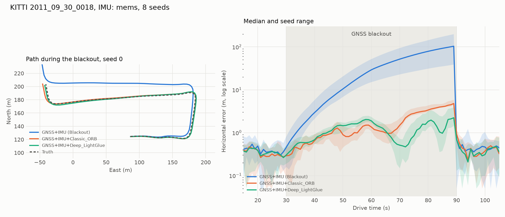

<div align="center">

# 📊 Ders 6 · Değerlendirme, Benchmark ve Sunum

**Faz 5** · ⏱️ ~3 saat · 📐 Matematik: ★★☆☆

[← Ders 5](05_stereo_visual_odometry.md) · [İçindekiler](README.md) · [Sözlük →](appendix_glossary.md)

</div>

---

## 🎯 Öğrenme hedefleri

- [ ] **ATE** ve **RPE**'yi tanımlamak, neyi ölçtüklerini ve neyi ölçmediklerini ayırt etmek
- [ ] **Trajectory alignment**'ın ne zaman meşru, ne zaman hile olduğunu açıklamak
- [ ] Sonuçları tek seed yerine **Monte Carlo** ile, medyan ve aralıkla raporlamak
- [ ] **NEES** ile bir estimator'ın belirsizliği konusunda dürüst olup olmadığını test etmek
- [ ] 3σ elipsoidini covariance'tan hesaplamak
- [ ] Bir projeyi grafik, video ve README ile dürüst ve etkileyici şekilde sunmak

---

## 💡 1. "İyi çalışıyor" ne demek?

Bir navigasyon sistemine sorulacak üç ayrı soru var. Her biri farklı bir metrikle ölçülür:

| Soru | Metrik | Projede |
|---|---|---|
| **Neredeyim?** Konumum gerçeğe ne kadar yakın? | **ATE** (Absolute Trajectory Error) | `ate_full_m`, `ate_blackout_m` |
| **Ne kadar hızlı sapıyorum?** Kısa vadeli hareketim ne kadar doğru? | **RPE** (Relative Pose Error) | `rpe_translation_blackout_m`, `rpe_rotation_blackout_deg` |
| **Kendi hatamı biliyor muyum?** Söylediğim belirsizlik gerçek mi? | **NEES** (consistency) | Alıştırma olarak (bölüm 5) |

Ek olarak, bu projenin asıl sorusu için özel bir metrik: **end-of-blackout error**, yani GNSS
geri gelmeden hemen önceki (t = 90 s) yatay hata. "En kötü anda ne kadar kaybolmuştum?"

💻 **Projede:** [evaluation.py](../../src/gnss_denied/evaluation.py) (ATE/RPE `evo` üzerinden) ve
[scripts/evaluate_metrics.py](../../scripts/evaluate_metrics.py) (benchmark).

---

## 📐 2. ATE: Absolute Trajectory Error

Her zaman adımında tahmin ile gerçek arasındaki konum farkı:

$$
\mathbf{e}_i = \hat{\mathbf{p}}_i - \mathbf{p}_i^{\text{gt}},
\qquad
\boxed{\text{ATE}_{\text{RMSE}} = \sqrt{\frac{1}{N}\sum_{i=1}^{N} \lVert \mathbf{e}_i \rVert^2}}
$$

**RMSE** (Root Mean Square Error) büyük hataları ortalamadan daha çok cezalandırır.

### Alignment: hile mi, gereklilik mi?

SLAM literatüründe ATE'den önce genelde **alignment** yapılır: tahmini gerçeğe en iyi oturtan
dönüşüm bulunur (**Umeyama** yöntemi) ve sonra hata ölçülür:

$$
(s^\ast, \mathbf{R}^\ast, \mathbf{t}^\ast) = \arg\min_{s,\mathbf{R},\mathbf{t}} \sum_i \big\lVert \mathbf{p}_i^{\text{gt}} - (s\,\mathbf{R}\,\hat{\mathbf{p}}_i + \mathbf{t}) \big\rVert^2
$$

| Durum | Alignment? | Neden? |
|---|---|---|
| SLAM, frame keyfi (ilk kare = orijin) | **SE(3)** ile evet | Başlangıç frame'i seçimi hata değil |
| Monocular VO, ölçek bilinemez | **Sim(3)** ile evet (ölçek dahil) | Ölçek zaten bilinemiyor, ceza vermek anlamsız |
| **GNSS-denied navigasyon** (bu proje) | **Hayır** ❌ | Tahmin ve gerçek zaten aynı coğrafi frame'de. Mutlak konumu bilmek sistemin **asıl işi**. Alignment, tam olarak ölçmek istediğimiz drift'i saklar. |

> [!WARNING]
> Bir blackout sonrası 100 m kaymış bir yörüngeyi alignment ile kaydırıp döndürürsen, ATE birkaç
> metreye inebilir. Bu sayıyı raporlamak teknik olarak "doğru" ama okuyucuyu yanıltır.
> Bir makalede ATE gördüğünde ilk sorun hep şu olmalı: **"Hangi alignment ile?"**

💻 [evaluation.py:1](../../src/gnss_denied/evaluation.py#L1), docstring bu kararı açıkça yazıyor.

---

## 📐 3. RPE: Relative Pose Error

ATE başta yapılan bir hatayı sonsuza kadar taşır. RPE ise **sadece $\Delta$ adımlık pencere
içindeki hareketin** doğruluğuna bakar:

$$
\mathbf{E}_i = \Big(\underbrace{(\mathbf{T}_i^{\text{gt}})^{-1}\,\mathbf{T}_{i+\Delta}^{\text{gt}}}_{\text{gerçek hareket}}\Big)^{-1}\;\Big(\underbrace{\hat{\mathbf{T}}_i^{-1}\,\hat{\mathbf{T}}_{i+\Delta}}_{\text{tahmini hareket}}\Big)
$$

$\mathbf{E}_i$ "gerçek hareket ile tahmini hareket arasındaki fark"tır. Ondan iki sayı çıkar:

$$
\text{RPE}_{\text{trans}} = \sqrt{\tfrac{1}{M}\textstyle\sum_i \lVert \text{trans}(\mathbf{E}_i) \rVert^2},
\qquad
\text{RPE}_{\text{rot}} = \sqrt{\tfrac{1}{M}\textstyle\sum_i \angle(\mathbf{E}_i)^2},
\quad
\angle(\mathbf{E}) = \arccos\frac{\text{tr}(\mathbf{R}_E) - 1}{2}
$$

Projede $\Delta$ = 10 poz = 10 s (estimate 1 Hz'de skorlanıyor).

### ATE ve RPE'nin farkı: projenin testlerinden

[tests/test_evaluation.py](../../tests/test_evaluation.py) elle hesaplanabilen yörüngelerle
metrikleri doğruluyor. İki test farkı mükemmel gösteriyor (araç 5 m/s ile düz gidiyor):

| Tahmindeki hata | ATE | RPE (10 adım) | Neden? |
|---|---|---|---|
| Sabit 5 m kayma (3, 4, 0) | **5.0 m** | **0** | Her yer 5 m yanlış, ama hareket tamamen doğru |
| %10 ölçek hatası | büyüyor | **5.0 m** | 10 adım = 50 m, %10'u = 5 m |

**Sezgi:** ATE "haritada neredeyim?", RPE "kilometre sayacım ne kadar doğru?" sorusunu cevaplar.

---

## 🎲 4. Monte Carlo: tek seed yalan söyler

### 🐞 Gerçek hata: seed 0 çok iyimserdi

İlk sonuçlar tek seed'le (seed 0) alındı: `mems` GNSS+IMU blackout sonu **38.7 m**. 8 seed
çalıştırılınca medyan **103.5 m** çıktı, en kötüsü **197.8 m**. Seed 0, 8 senaryonun **en iyisiydi**.

Seed neyi değiştiriyor? Hem GNSS gürültüsünü hem de `mems` profilinde IMU'ya eklenen gürültüyü
(turn-on bias dahil). Ders 3'ten hatırla: blackout hatası kalan gyro bias'ına $t^3$ ile bağlı. Bias
şanslıysa küçük, değilse büyük.

```python
for seed in range(args.seeds):
    gnss = list(GnssDegrader(replace(degrader_config, seed=seed)).degrade(truth))
    imu = list(corrupt_imu(raw_imu, replace(profile.injected, seed=seed)))
```

💻 [evaluate_metrics.py:85](../../scripts/evaluate_metrics.py#L85)

### Neden ortalama değil de medyan [min, max]?

| İstatistik | Avantaj | 8 örnekle sorun |
|---|---|---|
| Ortalama ± std | Alışılmış | Bir kötü seed ortalamayı sürükler; std simetrik varsayar ama hatalar simetrik değil |
| **Medyan [min, max]** | Outlier'a dayanıklı, aralık dürüst | Yok: tam olarak ne gözlendiyse onu söyler |

> [!TIP]
> **Dürüst raporlama kuralı:** Her sayının yanında nereden geldiğini yaz: kaç seed, hangi
> istatistik, hangi alignment, hangi süre. README'deki tablonun başlığı tam bunu yapıyor.

---

## 📐 5. NEES: estimator kendi hatasını biliyor mu?

Bir estimator sadece konum değil, covariance da raporlar. Bu covariance **doğru** mu? Ders 4'teki
Hata #3'te graph σ = 0.16 m diyordu, gerçek hata 2.26 m'ydi. Bunu yakalamak için:

$$
\boxed{\varepsilon_i = \mathbf{e}_i^\top\,\boldsymbol{\Sigma}_i^{-1}\,\mathbf{e}_i}
\qquad\text{(Normalized Estimation Error Squared)}
$$

Estimator **tutarlı** (**consistent**) ise, yani gerçek hata gerçekten $\mathcal{N}(\mathbf{0}, \boldsymbol{\Sigma})$'dan
geliyorsa, $\varepsilon$ serbestlik derecesi 3 olan bir **chi-square** dağılımı izler:

$$
\varepsilon \sim \chi^2_3, \qquad \mathbb{E}[\varepsilon] = 3
$$

| Ortalama NEES | Anlamı |
|---|---|
| ≈ 3 | ✅ Tutarlı: söylediği belirsizlik gerçek |
| ≫ 3 | ❌ **Overconfident**: hatasını küçümsüyor. Tehlikeli! |
| ≪ 3 | ⚠️ **Underconfident**: fazla temkinli; bilgiyi israf ediyor |

$N$ bağımsız çalıştırmanın ortalaması için %95 kabul aralığı: $N\bar{\varepsilon} \sim \chi^2_{3N}$.
Örneğin $N$ = 8 için $\chi^2_{24}$'ün %2.5 ve %97.5 noktaları 12.4 ve 39.4; 8'e bölünce
$\bar{\varepsilon} \in [1.55,\ 4.92]$.

**Hata #3'ün NEES'i (1D yaklaşık):** $(2.26 / 0.16)^2 \approx 200$. Beklenen 1. Felaket.

> [!NOTE]
> Projede henüz bir NEES modülü yok. `FusionStep.fused.position_covariance_m2` ve
> `truth_enu_m` zaten mevcut, yani bu, kursun sonunda yazabileceğin ilk özellik için mükemmel
> bir aday (alıştırma 3).

---

## 📊 6. Sonuçları okumak



| IMU | Mod | ATE blackout (m) | Blackout sonu (m) | RPE 10 s trans (m) | RPE 10 s rot (°) |
|---|---|---|---|---|---|
| `mems` | GNSS+IMU | 51.24 | 103.55 [38.71, 197.84] | 18.79 | 0.28 |
| `mems` | + ORB | 2.61 | 4.79 [4.44, 5.88] | 1.51 | 0.31 |
| `mems` | + ALIKED | 1.96 | **2.23** [1.44, 3.89] | 1.06 | 0.38 |

Bu tablodan çıkan dört ders (README'deki "How to read these numbers" bölümü):

1. **Vision drift'in çoğunu siliyor.** Blackout sonu hata %92–98 azalıyor.
2. **Öğrenilmiş front-end genel olarak daha iyi, her an değil.** Grafikte ≈ 45–65 s arasında
   ORB önde. Ortalama bir sayı bunu gizler; **zaman serisi** grafiği gösterir.
3. **Kare başı daha iyi eşleşme ≠ daha az drift.** (Ders 5'teki bias vs variance.)
4. **Vision attitude'a yardım etmiyor.** Rotation RPE `mems`'te 0.28°'den 0.38°'ye kötüleşiyor.
   Muhtemel neden: VO rotation sigma'sı (1e-3 rad) her front-end için ayrı ayarlanmadı.

> [!IMPORTANT]
> 4. madde gibi **kötü** bir sonucu saklamamak, projeye güveni artırır. "Her şey harika" diyen bir
> benchmark'a kimse inanmaz.

### Grafik tasarımı neden böyle?

| Seçim | Neden? |
|---|---|
| **Log ölçekli** y ekseni | Hatalar 0.5 m ile 200 m arasında. Lineer ölçekte vision eğrileri sıfırda düz bir çizgi olurdu. |
| Medyan çizgi + seed **bandı** | Hem tipik davranışı hem belirsizliği tek bakışta gösterir. |
| Gri **blackout** bölgesi | Okuyucu "olay nerede?" diye aramaz. |
| Doğrulanmış renk paleti (`#2a78d6`, `#eb6834`, `#1baf7a`) | Renk körlüğünde de ayırt edilebilir; renkler sırayla atanır, rastgele değil. |

💻 [viz/plots.py](../../src/gnss_denied/viz/plots.py), `plot_benchmark`.

---

## 📐 7. Görselleştirme: 3σ elipsoidi

Rerun'daki şeffaf elipsoid, tahminin belirsizliğini gösterir. Covariance'tan hesabı:

$$
\boldsymbol{\Sigma} = \mathbf{V}\,\boldsymbol{\Lambda}\,\mathbf{V}^\top
\qquad\text{(eigendecomposition)}
$$

- $\mathbf{V}$'nin sütunları elipsoidin **eksen yönleri**.
- Yarı eksen uzunlukları: $3\sqrt{\lambda_i}$.

```python
eigenvalues, eigenvectors = np.linalg.eigh(covariance_m2)   # simetrik matris için eigh
```

💻 [rerun_logger.py:21](../../src/gnss_denied/viz/rerun_logger.py#L21)

> [!NOTE]
> 1D'de ±3σ, olasılığın %99.7'sini kapsar. 3D'de 3σ elipsoidi sadece **%97.1**'ini kapsar, çünkü
> $P(\chi^2_3 \le 9) = 0.971$. Boyut arttıkça "kaç sigma" sezgisi değişir.

### Rerun ile kendi çalıştırmanı incele

```bash
uv run --extra all python scripts/run_pipeline.py --imu-profile mems --vo aliked
uv run --extra all rerun assets/blackout_mems_aliked.rrd
```

| Entity | Ne gösteriyor? |
|---|---|
| `world/ground_truth` | RTK yörüngesi |
| `world/fused` | Graph'ın online tahmini |
| `world/dead_reckoning` | Yardımsız IMU |
| `world/gnss` | Degrader'dan çıkan fix'ler |
| `world/fused_3sigma` | Belirsizlik elipsoidi (blackout'ta büyüdüğünü izle!) |
| `errors/*` | Zaman serisi olarak hatalar |

---

## 🎬 8. Sunum: video ve README

Bir projenin değeri, başkalarının onu **anlayabildiği** kadardır.

### Demo videosu ([assets/demo.mp4](../../assets/demo.mp4))

`scripts/render_demo.py`'deki kararlar ve nedenleri:

| Karar | Neden? |
|---|---|
| **Medyan seed** otomatik seçiliyor | En iyi seed'i göstermek cherry-picking olur. Video "tipik" davranışı göstermeli. ([demo_timeline.py:54](../../src/gnss_denied/viz/demo_timeline.py#L54)) |
| Video zamanı → sürüş zamanı **piecewise-linear** | Sıkıcı kısımlar hızlı, blackout anı yavaş akar. Sağ alttaki "Playback ×" o anki hızı gösterir. |
| Alt yazı ve sonuç kartı **yok** | Ekrandaki her sayı canlı veriden geliyor; durum sadece sağ üstteki "GNSS Available" / "GNSS Unavailable" yazısıyla gösteriliyor. Anlatımı videoyu sunan kişi yapıyor. |
| Yeşil noktalar | ALIKED keypoint'leri ve LightGlue'nun önceki kareyle eşleşmeleri; çizgiler görüntüdeki yer değiştirme. "PnP inliers used" sayacı hareket için gerçekten kullanılan alt küme. |

### 🐞 Gerçek hata: videodaki yanlış alt yazı

İlk versiyonda alt yazı "hata 1.4–4.4 m'de **kalıyor**" diyordu. Ama hata blackout boyunca büyüyordu;
1.4–4.4 m sadece **bitişteki** aralıktı. Doğrusu: "blackout'u sadece ... ile **bitiriyor**".

**Ders:** Görsel materyaldeki her cümle, bir sonuç iddiasıdır. Tablodaki sayılarla aynı titizlikle
kontrol edilmeli. (Sonraki sürümde alt yazılar tamamen kaldırıldı; ama ekrana yazdığın her
cümle için bu kural geçerli.)

### Bir README'nin anatomisi

Projenin [README.md](../../README.md)'si şu sırayı izliyor: 1) **GIF** (5 saniyede ne yaptığını
gösterir), 2) mimari diyagram, 3) quickstart, 4) sonuç tablosu, 5) **sonuçların nasıl okunacağı**,
6) **limitasyonlar**, 7) good first issues. 5. ve 6. maddeler çoğu projede yoktur; olması güven verir.

---

## 🏁 9. Capstone: projeyi sıfırdan yeniden yaz

Kursu bitirdin. Şimdi en iyi öğrenme yöntemi: **bu repoya bakmadan** baştan yazmak. Her adımın
kabul kriteri (gate) var:

- [ ] **Faz 1** · `LocalEnuFrame` + testler. Gate: round-trip < 1 mm. *(Ders 1)*
- [ ] **Faz 2** · KITTI loader, LIS filtresi, `merge_streams`, GNSS ve IMU degrader. Gate: üç akış tek zaman ekseninde, monoton. *(Ders 2)*
- [ ] **Faz 3a** · `DeadReckoner`. Gate: kusursuz (gürültüsüz) bir IMU ile 60 s'lik bir çember
  yörüngesini 0.3 m'den az hatayla takip etmek; first-order integration'ın kendi hatası ≈ 0.24 m
  ([test_factor_graph.py:90](../../tests/test_factor_graph.py#L90)). *(Ders 3)*
- [ ] **Faz 3b** · `FactorGraphEstimator` (IMU + GNSS). Gate: blackout'ta drift görünür, ilk fix'te toparlanır. *(Ders 4)*
- [ ] **Faz 4** · Stereo VO (önce ORB, sonra deep). Gate: blackout sonu hata > %80 azalır. *(Ders 5)*
- [ ] **Faz 5** · Benchmark, 8 seed, tablo, grafik. Gate: her sayının kaynağı belli. *(Ders 6)*

### Sonraki adımlar: kendi katkın

| Fikir | Ne öğretir? | Zorluk |
|---|---|---|
| **NEES modülü** | Consistency, chi-square | ★★☆☆ |
| **Spoofing savunması**: GPSFactor'e robust kernel + innovation gating | Robust estimation, hipotez testi | ★★★☆ |
| **Allan variance** ile IMU parametrelerini veriden bulmak | Sensör karakterizasyonu | ★★☆☆ |
| **Başka bir KITTI sürüşünde** doğrulama (held-out) | Genelleme, overfitting | ★★☆☆ |
| **Satellite map matcher** (README good first issue #1) | Cross-view matching, absolute factor | ★★★★ |
| **Neural IMU denoiser** (good first issue #2) | Deep learning + navigasyon | ★★★★ |

**Spoofing için ipucu (innovation gating):** Her fix için tahminle farkı ($\boldsymbol{\nu}$) ve
beklenen belirsizliğini ($\mathbf{S} = \boldsymbol{\Sigma}_{\text{tahmin}} + \boldsymbol{\Sigma}_{\text{fix}}$) hesapla:

$$
d^2 = \boldsymbol{\nu}^\top\,\mathbf{S}^{-1}\,\boldsymbol{\nu}
\quad > \quad \chi^2_{3,\,0.99} = 11.34
\quad\Rightarrow\quad \text{fix'i reddet}
$$

Ama dikkat: 1 m/s'lik yavaş bir spoofing ramp'ı her adımda küçük bir innovation üretir ve tek tek
testi geçebilir. Bunu yakalamak için innovation'ların **zaman içindeki toplamına** (örneğin
**CUSUM**) bakmak gerekir. İşte gerçek bir araştırma problemi.

---

## 🧪 Alıştırmalar

**1.** Bir yörüngede her noktada hata $(1, 1, 0)$ m. ATE nedir? RPE nedir?

<details>
<summary>Çözüm</summary>

ATE = $\sqrt{2} \approx 1.41$ m. RPE = 0 (sabit kayma, hareket doğru). SE(3) alignment yapılsaydı ATE de 0 olurdu.

</details>

**2.** Varsayalım 8 seed'in blackout sonu hataları şöyle (uç değerler projeden, aradakiler
uydurma): 38.7, 62, 85, 98, 109, 131, 160, 197.8 m. Medyan nedir?
Ortalama nedir? Hangisini raporlarsın?

<details>
<summary>Çözüm</summary>

Medyan = (98 + 109)/2 = 103.5 m. Ortalama = 881.5/8 ≈ 110.2 m. Medyan [min, max] = 103.5 [38.7, 197.8].
Dağılım sağa çarpık; ortalama uç değerlere doğru kayıyor. Medyan ve aralık daha dürüst.

</details>

**3. (Kod)** `src/gnss_denied/evaluation.py`'ye bir `nees(result)` fonksiyonu ekle: her `FusionStep`
için $\mathbf{e}^\top\boldsymbol{\Sigma}^{-1}\mathbf{e}$ hesapla (sadece konum, 3D). Blackout
içinde ve dışında ortalamasını yazdır. Estimator overconfident mi?

<details>
<summary>İpucu</summary>

`step.fused.position_enu_m - step.truth_enu_m` hatayı, `step.fused.position_covariance_m2`
covariance'ı verir. `np.linalg.solve(cov, e)` kullan, `inv` değil. Önce bir test yaz: covariance
$\sigma^2\mathbf{I}$ ve hata $\sigma(1,1,1)$ ise NEES = 3 olmalı.

</details>

**4.** Bir covariance $\text{diag}(4, 1, 0.25)$ m². 3σ elipsoidinin yarı eksenleri nedir?

<details>
<summary>Çözüm</summary>

$3\sqrt{4} = 6$ m, $3\sqrt{1} = 3$ m, $3\sqrt{0.25} = 1.5$ m. Eksenler koordinat eksenleriyle hizalı
(covariance zaten diagonal).

</details>

---

## ✅ Kendini kontrol et

- ATE ile RPE arasındaki farkı tek cümleyle anlatabilir misin?
- Bu projede alignment neden yapılmıyor? Hangi durumda yapılması doğru olurdu?
- Tek seed ile rapor vermenin tehlikesi nedir?
- Ortalama NEES 30 çıkarsa estimator hakkında ne söylersin?
- Videoda neden medyan seed gösteriliyor?

---

<div align="center">

### 🎓 Tebrikler, kursu tamamladın!

Artık GNSS'siz bir navigasyon sisteminin **neden** drift ettiğini, **nasıl** füzyon yapıldığını ve
sonuçların **dürüstçe** nasıl ölçüleceğini biliyorsun.

[← Ders 5](05_stereo_visual_odometry.md) · [İçindekiler](README.md) · **[📚 Sözlük ve formül kartı →](appendix_glossary.md)**

</div>
