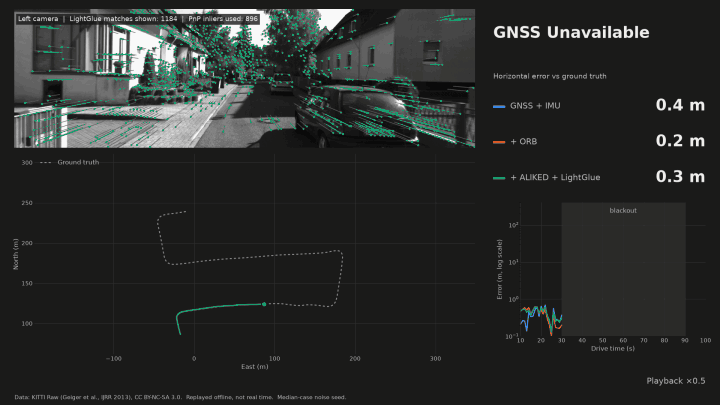

<div align="center">

# 🛰️ GNSS-Denied Navigation Kursu

### Sıfırdan, matematiğiyle birlikte: bu projeyi kendi başına yazabilecek hale gel



*Uydu sinyali 60 saniye boyunca yok. Sadece IMU ile 100 m sapan araç, kamera eklenince 2 m'de kalıyor.*

</div>

---

## 📖 Bu kurs nedir?

Bu klasör, `Open-GNSS-Denied` projesini **bir ders kitabı gibi** anlatır. Her derste önce
**sezgi** (neden?), sonra **matematik** (nasıl?), en sonunda **kod** (projede nerede?) gelir.
Kursun sonunda:

- Bir aracın konumunu GNSS olmadan nasıl tahmin edeceğini **matematiksel olarak** açıklayabilirsin.
- IMU, GNSS ve kamerayı bir **factor graph** içinde birleştiren bir sistemi sıfırdan yazabilirsin.
- Sonuçlarını **ATE / RPE** ile ölçüp dürüstçe raporlayabilirsin.

> [!NOTE]
> **Dil kuralı:** Anlatım Türkçe, ama bütün teknik terimler orijinal İngilizce halleriyle kalıyor
> (`factor graph`, `bias`, `covariance`...). Literatürü, kütüphane dokümantasyonunu ve makaleleri
> okurken aynı kelimelerle karşılaşacaksın. Bilmediğin bir terim için
> [📚 Sözlük ve Formül Kartı](appendix_glossary.md)'na bak.

---

## 🗺️ Yol haritası

```mermaid
flowchart LR
    L0["0 · Büyük resim<br/><i>problem ve fikir</i>"]
    L1["1 · Geodesy<br/><i>koordinatlar ve dönüşümler</i>"]
    L2["2 · Veri ve simülasyon<br/><i>KITTI, gürültü modelleri</i>"]
    L3["3 · IMU<br/><i>dead reckoning</i>"]
    L4["4 · Factor graph<br/><i>GTSAM ile füzyon</i>"]
    L5["5 · Visual odometry<br/><i>stereo + deep features</i>"]
    L6["6 · Değerlendirme<br/><i>ATE, RPE, sunum</i>"]
    L0 --> L1 --> L2 --> L3 --> L4 --> L5 --> L6
    classDef phase fill:#2a78d6,stroke:#1d5aa3,color:#fff
    classDef core fill:#eb6834,stroke:#b84d22,color:#fff
    classDef finish fill:#1baf7a,stroke:#137f58,color:#fff
    class L0,L1,L2 phase
    class L3,L4,L5 core
    class L6 finish
```



| # | Ders | Projedeki faz | Ana matematik | Zorluk | Süre |
|---|---|---|---|---|---|
| 0 | [🧭 Büyük resim](00_big_picture.md) | — | Olasılık sezgisi, sensör tipleri | ★☆☆☆ | ~1 saat |
| 1 | [🌍 Geodesy ve koordinat sistemleri](01_geodesy_and_frames.md) | Faz 1 | Ellipsoid, rotation matrix, SE(3), covariance propagation | ★★☆☆ | ~3 saat |
| 2 | [📦 Veri ve sensör simülasyonu](02_data_and_simulation.md) | Faz 2 | Gaussian / Cauchy dağılımları, noise density, random walk | ★★☆☆ | ~3 saat |
| 3 | [⚙️ IMU ve dead reckoning](03_imu_and_dead_reckoning.md) | Faz 3 (a) | Strapdown kinematics, SO(3), Exp/Log, hata büyümesi | ★★★☆ | ~4 saat |
| 4 | [🕸️ Factor graph ile füzyon](04_factor_graphs_and_gtsam.md) | Faz 3 (b) | MAP, nonlinear least squares, Gauss-Newton, preintegration, ISAM2 | ★★★★ | ~6 saat |
| 5 | [📷 Stereo visual odometry](05_stereo_visual_odometry.md) | Faz 4 | Pinhole model, disparity, PnP, RANSAC, Huber | ★★★☆ | ~5 saat |
| 6 | [📊 Değerlendirme ve sunum](06_evaluation_and_showcase.md) | Faz 5 | ATE, RPE, Monte Carlo, NEES | ★★☆☆ | ~3 saat |
| A | [📚 Sözlük ve formül kartı](appendix_glossary.md) | — | Bütün formüller tek sayfada | — | referans |

---

## 🧰 Önkoşullar

| Konu | Ne kadarı lazım? | Hızlı tekrar |
|---|---|---|
| **Lineer cebir** | Matris çarpımı, transpose, inverse, eigenvalue | 3Blue1Brown, *Essence of Linear Algebra* |
| **Olasılık** | Gaussian dağılım, mean, variance, covariance matrix | Ders 0 ve Ders 2 içinde tekrar ediliyor |
| **Calculus** | Türev, integral, Jacobian (çok değişkenli türev) | Ders 3'te gerektiği yerde anlatılıyor |
| **Python** | `numpy` array işlemleri, `dataclass`, generator | Projenin kendisi iyi bir örnek |

> [!TIP]
> Matematik gözünü korkutmasın. Her formülden önce **"bu formül ne söylüyor?"** sorusunun cevabı
> Türkçe olarak yazıldı. Formülü ilk okumada atlayıp sezgiyi alabilir, sonra geri dönebilirsin.

---

## 🎓 Her ders nasıl kurgulandı?

Her ders aynı iskeleti izler, böylece nerede ne olduğunu hep bilirsin:

| Bölüm | İçerik |
|---|---|
| 🎯 **Öğrenme hedefleri** | Dersin sonunda ne yapabileceğin |
| 💡 **Sezgi** | Formülsüz, günlük dille açıklama |
| 📐 **Matematik** | Formüller ve türetmeleri |
| 💻 **Projede nerede?** | İlgili dosya ve satıra doğrudan link |
| 🐞 **Gerçek hata** | Bu projeyi yazarken gerçekten yaşanan bir hata ve dersi |
| 🧪 **Alıştırmalar** | Açılır kutularda çözümleriyle |
| ✅ **Kendini kontrol et** | Bir sonraki derse geçmeden önce cevaplayabilmen gereken sorular |

---

## 🏁 Kursu bitirince: capstone

Kursun son hedefi, bu repoyu **bakmadan** yeniden yazabilmek. Her fazın bir **gate** (kapı)
koşulu var; o koşulu sağlamadan bir sonraki faza geçme:

| Faz | Gate (geçme koşulu) | Bu projede elde edilen |
|---|---|---|
| 1 | WGS84 → ENU → WGS84 round-trip hatası < 1 mm | ≈ 9 nm |
| 2 | IMU, GNSS ve kamera akışları tek zaman ekseninde sıralı | ✅ 8 bozuk OXTS paketi temizlendi |
| 3 | Blackout'ta sapma görünür, ilk fix'te sistem toparlanır | ✅ |
| 4 | Vision eklenince blackout sonu hatası **> %80** azalır | **%97.8** (`mems`) |
| 5 | 8 seed üzerinde ATE / RPE tablosu ve grafik | ✅ |

```bash
uv sync --python 3.11 --extra all
uv run --extra all pytest
```

Hazırsan: **[Ders 0 · Büyük resim →](00_big_picture.md)**
